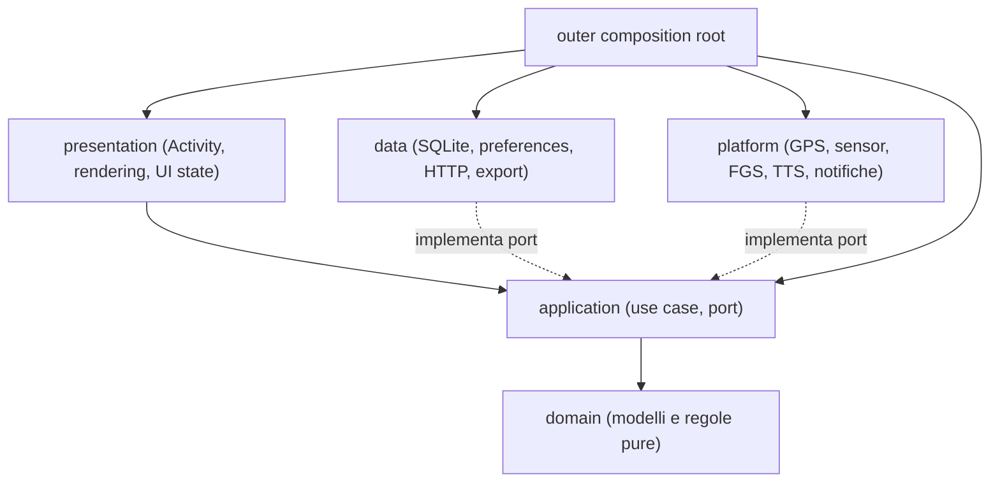

# ADR-002 — Refactoring architetturale progressivo di tutta PassoLibero

- **Stato:** PROPOSTA — in attesa dell'approvazione esplicita del maintainer
- **Data:** 2026-11-09
- **Owner decisione:** maintainer del repository
- **Baseline esaminata:** `main` @ `14effdeb6b8909a8e3110c3e432ee25e82d168a4`
- **Documenti correlati:** [ADR-001 / Clean Architecture](../clean-architecture.md), [architettura attuale](../architecture.md), [invarianti](../invariants.md), [standard Java](../coding-standards.md), [mappa dipendenze](../refactoring/dependency-map.md), [backlog PR](../refactoring/pr-backlog.md)
- **Ambito:** architettura dell'intera app, incluse funzionalità meteo, aggiornamenti, mappe, voce, storico e diagnostica `debug`
- **Tipo di modifica proposta:** refactoring senza cambiamenti intenzionali di comportamento, UI, API pubbliche dell'APK o formato dei dati

> **Gate di approvazione:** la presenza di questo documento in una PR non autorizza ad avviare refactoring. Finché lo stato è **PROPOSTA**, non creare issue operative, non assegnare agenti per la migrazione e non modificare codice sulla base di questa ADR. Il maintainer deve approvare esplicitamente architettura, sequenza e criteri di accettazione; solo dopo portare lo stato ad **ACCETTATA** e aprire le issue operative.

## 1. Contesto e problema

PassoLibero è una app Android Java 17, `minSdk=30` (Android 11), `compileSdk=35`, con un solo modulo applicativo Gradle. Le feature di tracking offline, storico SQLite, UI, cartografia osmdroid, sprint, TTS, meteo, updater e diagnostica debug funzionano ma molte dipendono direttamente da classi nel package legacy `it.example.passolibero`.

Nella baseline esaminata vi sono **50 file Java in `src/main`**, dei quali **47** nel package radice e **3** nel package `domain`. I componenti con particolare concentrazione di responsabilità includono `TrackingService` (~973 righe), `ActiveSessionActivity` (~655), `WeatherSettingsActivity` (~475), `TrackMap` (~374), `SessionDetailActivity` (~352), `TrackerDb` (~327). In `src/debug`, `BatteryDiagnosticsActivity.java` contiene anche la classe `BatteryRecorder`, mentre `BatteryAutoCapture` gestisce scheduling/stato statico di acquisizione.

Le issue #5 e #6 hanno costruito una baseline di regressione e isolato tre politiche pure: `SessionRecoveryPolicy`, `ForegroundStartPolicy`, `GpsFixPolicy`. Restano ancora accoppiamenti Activity→SQLite/SharedPreferences, Service→persistenza+TTS+sensori e componenti feature che combinano rete, regole, scheduling e rendering.

**Problema da risolvere:** rendere i cambiamenti degli agenti AI piccoli, prevedibili, testabili e revisionabili senza mettere a rischio i dati locali e il comportamento già verificato sul dispositivo reale. Lo spostamento fisico di file **non è** di per sé una prova di corretta architettura.

## 2. Decisione proposta

**Adottare un refactoring progressivo guidato dai contratti**, sulla base di ADR-001 e delle dipendenze della Clean Architecture, con un *seam* verificabile alla volta.

Principi vincolanti:

1. **Invarianti prima della struttura.** Documentare il comportamento preesistente e costruire test di equivalenza (input, output, side effect, ordine temporale) prima di spostarlo.
2. **Unità di cambiamento piccola.** Una issue e una PR coerente per ogni seam; nessuna riscrittura dell'intera app, nessun mass-rename in una PR funzionale.
3. **Dipendenze verso l'interno.** `domain` senza Android/rete/SQLite; `application` coordina casi d'uso e conosce solo port e dominio; `data` e `platform` implementano adapter; `presentation` si limita a rendering/interazione con casi d'uso.
4. **Interfacce soltanto ai confini reali.** Port di lettura/scrittura dove aiutano a disaccoppiare UI, service e data; nessuna gerarchia DI fittizia o interfaccia per ogni classe.
5. **Composition root esplicita negli adapter esterni.** La composizione dei concreti deve restare fuori da `domain`/`application`; l'Activity Android riceve casi d'uso tramite un contratto interno o factory di composizione, non importa direttamente adapter `data`/`platform` migrati. La forma concreta va decisa e testata nella PR iniziale di wiring.
6. **Modello e persistenza separati.** `RunState` e il DB non migrano per semplice spostamento: introdurre prima snapshot/value object Android-free e mapper con test byte/valore-equal; nessuna modifica di chiavi, schema o significato dei campi.
7. **Un modulo Gradle inizialmente.** Java 17, AGP/SDK e dipendenze attuali; non aggiungere Kotlin, Compose, Hilt/Dagger o nuovi moduli solo per rappresentare i layer.
8. **Separazione rigorosa del canale privilegiato.** Firma/release, Actions privilegiate, permessi e updater sono superfici ad alto rischio: review distinta, dry run e stessa firma dell'APK.

### Architettura desiderata



`domain` e `application` non importano classi Android, `SQLiteDatabase`, `SharedPreferences`, `HttpURLConnection` o componenti UI. Le implementazioni platform/data possono conoscere API Android e librerie esterne. `presentation` usa modelli di presentazione e use case, non interroga direttamente `TrackerDb` per il flusso migrato.

Struttura di destinazione **indicativa, non ordine di spostamento obbligatorio**:

```text
it.example.passolibero/
  domain/{tracking,session,sprint,weather,update}/
  application/{tracking,history,weather,update}/
  data/{local,remote,export}/
  platform/{location,sensors,service,speech,notifications}/
  presentation/{home,session,history,weather,update}/
  [composition root esterna, da definire nel primo seam di wiring]
```

Le regole pure legacy già testate possono essere migrate mantenendo le API stabili mediante facade temporanee. Non forzare `UpdateManager` o `WeatherMonitor` ad adottare tutte le astrazioni nello stesso passaggio.

## 3. Responsabilità e contratti di confine

| Area | Responsabilità finale | Confine e contratto da fissare prima di migrare |
| --- | --- | --- |
| Tracking (domain) | qualità fix, evidenza movimento, ledger dei tempi, distanza, sprint, statistiche | input con unità e timestamp monotoni espliciti; risultati deterministici, `UNKNOWN` quando manca evidenza |
| Sessione (application) | start, aggiornamento, recupero e stop esplicito | nessuna sessione fuori da START; snapshot coerenti anche dopo kill/reboot; side effect ordinati |
| GPS/sensori (platform) | registrazione/unregistrazione Android, callback, conversione timestamp | nessun fix stale/futuro accettato; assenza sensori e permessi non causa crash |
| Persistenza (data/local) | lettura/scrittura snapshot, sessioni, punti, sprint, preferenze | preservare `sessions.db`, versione/schema e chiavi prefs, ID, ordine punti e transazioni |
| Presentazione | schermate, input utente, formattazione e navigazione | nessuna regola di classificazione o SQL nella UI migrata |
| Mappa | overlay osmdroid, segmenti, viewport e interazioni | non unire segmenti dopo dropout; coordinate rimangono locali salvo tile provider |
| Meteo | ricerca, forecast, filtri, slot, scheduler e notifiche | no GPS background per scelta città; no fetch implicito non autorizzato; orari/fusi e regole invariati |
| Aggiornamento | check, download, hash, certificato, richiesta installazione | `versionCode` monotono, certificato compatibile, nessun bypass verifica; UI non può installare un APK non validato |
| Voce | sintesi e audio focus attraverso adapter, pianificazione annunci separata | stessa priorità per sprint, pause, ripartenza e segnalazioni GPS |
| Diagnostica debug | `BatteryAutoCapture`, recorder, CSV e UI diagnostica | rimane **solo debug**, opt-in, senza coordinate nei report; non aggiungere servizi GPS propri |

La [mappa delle dipendenze](../refactoring/dependency-map.md) contiene i riferimenti concreti alle classi correnti e segnala i passaggi più rischiosi. Il [backlog](../refactoring/pr-backlog.md) definisce piccoli incrementi, prerequisiti e gate, non issue già autorizzate.

## 4. Invarianti non negoziabili

- **Android 11:** `minSdk=30` invariato, API 34+ sempre protette da controllo runtime, `verify` e `android11` richiesti.
- **Identità app e aggiornamenti:** `applicationId=it.example.passolibero`, certificato di firma debug originale, updater e meccanismo `versionCode` conservati. Nessuna modifica a signing, release workflow o secret in PR architetturali.
- **SQLite/Preferences:** nessuna migrazione distruttiva, nessuna perdita di storico, punti, sprint, preferenze o sessioni; schemi/chiavi e serializzazione **invariati** finché un cambiamento funzionale non sia approvato separatamente.
- **GPS e tempi:** nessuna attività inventata, nessuna retroattribuzione di intervalli incerti, nessun doppio conteggio, stessa frequenza di campionamento, soglie, units e conservazione dei tempi.
- **Lifecycle:** START esplicito, FGS compatibile con Android, nessuna raccolta fuori sessione; ripresa, background, schermo bloccato e stop conservativi.
- **Privacy e offline:** tracciati e sessioni restano sul telefono; core tracking/storico funzionano senza rete. Non introdurre destinazioni rete/telemetria.
- **Funzionalità visibili:** stessa UI, percorsi, testo, notifiche, voce e comportamento salvo issue funzionale separata.
- **Diagnostica:** codice `src/debug` escluso dalla build release; niente acquisizioni automatiche aggiuntive o modifica a durata/sampling.

## 5. Migrazione e testing

**Protocollo per singola PR di refactoring:**

1. Fotografare il contratto: chiamanti, side effect, timestamp, regole di null/errore e dati persistiti.
2. Aggiungere caratterizzazione/fixture di equivalenza contro l'implementazione precedente; includere avvio, errori e casi limiti.
3. Estrarre un seam o introdurre una facade/port senza modifiche di comportamento; mantenere mapper o compatibility layer fino al passaggio di tutti i client.
4. Verificare le dipendenze tramite `tests/check-architecture.py`, Spotless AOSP e review di package-private, Manifest e reflection.
5. Eseguire `sh tests/run-core-tests.sh`, migrazioni SQLite, `verify` e `android11`; per hardware/permessi/upload aggiornamenti prevedere collaudo reale specifico. Dichiarare cosa **non** è stato testato.
6. Review del maintainer e merge su `main` soltanto con controlli verdi; poi controllare CI post-merge. Un merge non equivale ad autorizzazione della prossima PR.

**Batteria/performance:** prima di migrazioni sul percorso caldo GPS registrare una baseline con strumentazione debug già presente e condizioni comparabili; non attribuire alla sola app il consumo elettrico totale del telefono. Conservare il CSV locale senza coordinate. Un'ottimizzazione di consumo è feature separata, non parte di un refactor puramente strutturale.

**Dati:** per ogni modifica ai mapper/persistenza eseguire round-trip, apertura di DB storici e installazione **sopra** una versione precedente firmata identicamente, con backup dell'utente prima di test rischiosi. Non usare uninstall come procedura di migrazione.

**Rollback:** revert del singolo merge mediante nuova PR, mantenendo forma del DB/prefs; non abbassare `versionCode` già pubblicati e non sostituire l'APK pubblicato con file diversi. Se una regressione riguarda un update distribuito, il fix deve usare un nuovo `versionCode` con la firma esistente.

## 6. Decisioni scartate e trade-off

| Alternativa | Esito | Motivazione |
| --- | --- | --- |
| Riscrivere tutta l'app in una PR | Rifiutata | Impossibile distinguere regressioni e cause, rischio perdita dati |
| Movere tutti i Java in nuovi package in blocco | Rifiutata | Diff di soli rename ma alto rischio Manifest, visibilità e reflection |
| Multi-modulo Gradle immediato | Rinviato | Costo e complessità non giustificati dalla baseline |
| Framework DI o cambio linguaggio/UI | Fuori scope | Nessun beneficio certo per la migrazione iniziale |
| Lasciare il legacy com'è | Rifiutata | Continua ad accoppiare UI, Android e persistenza |
| Refactor iterativo con porte minime e test | **Proposto** | Protegge dati, facilita review e rollback, rende possibile la migrazione per feature |

Rischi residui: comportamento batterie/OEM non rappresentato nell'emulatore; bug latenti non coperti dai test; differenze nei side effect di persistenza asincrona; upgrade di schema storico; reflection in `TrackingService` verso la diagnostica debug; perdita di ordering tra callback del worker e UI; residui di accesso diretto da presentation. Mitigazioni nel backlog e review specifiche.

## 7. Governance: da progetto proposto a progetto eseguibile

La ADR diventerà **ACCETTATA** solo dopo che il maintainer avrà rivisto e confermato:

- [ ] Obiettivo: stesso comportamento e stessa UI, solo riorganizzazione interna.
- [ ] Direzione delle dipendenze, composition root, criteri delle interfacce e struttura package.
- [ ] Baseline e rischi di dati, FGS, firma, updater, meteo e codice debug.
- [ ] Priorità e dipendenze dei piccoli lotti nel backlog; nessun batch di rename.
- [ ] Gate di test automatici, test sul telefono, privacy e rollback.
- [ ] Decisione su cosa resta legacy temporaneamente e quando interrompere una migrazione.

**Solo dopo l'accettazione:**
1. aggiornare qui `Stato: ACCETTATA` con data/decisione;
2. creare una issue *epic* e le issue operative dal backlog, assegnando milestone e dipendenze;
3. assegnare agli agenti una issue circoscritta alla volta; includere questa ADR, la mappa e `docs/invariants.md` nel contesto;
4. aprire PR d'implementazione piccole senza merge autonomo degli agenti.

### Criteri di completamento dell'intero programma

- Ogni area è assegnata a un owner di layer e i confini concreti sono descritti e verificabili.
- Il codice migrato non contiene import proibiti, dipendenze dirette UI→SQL o regole business negli adapter; le eventuali eccezioni legacy residue sono elencate e motivate.
- `TrackingService` orchestra gli adapter e i casi d'uso senza contenere policy di classificazione o logica di persistenza.
- Le suite di regressione coprono tempi, GPS out-of-order, lifecycle, migrazione dati, meteo, updater e debug; `verify` e `android11` verdi dopo ogni fase.
- Aggiornamento sopra vecchia installazione, storico conservato, nuova sessione e funzionalità principali collaudati su device reale prima della release.
- Non serve cancellare dati, cambiare certificato o aumentare minSdk.

**Questa ADR autorizza la progettazione e la discussione, non l'implementazione finché rimane PROPOSTA.**
