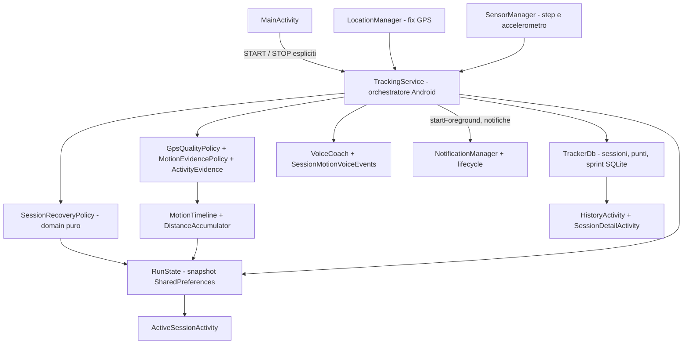

# Architettura PassoLibero (baseline main)

Questa descrizione riguarda il codice presente in `main` e il percorso incrementale della [issue #6](https://github.com/VittorioS/app-running/issues/6). PassoLibero V2 (PR #2) è già integrata; i prossimi refactor avvengono in PR autonome, dopo i test della issue #5.

## Flusso dati

`MainActivity` avvia esplicitamente `TrackingService` (foreground service). Il servizio riceve fix GPS e callback dei sensori e valuta attendibilità/attività tramite `GpsQualityPolicy`, `MotionEvidencePolicy`, `ActivityEvidence`, `MovementClassifier`, `InertialGaitDetector` e `StepCounterEvidence`. `MotionTimeline` contabilizza gli intervalli con timestamp monotoni. `DistanceAccumulator` filtra jitter e somma gli spostamenti attendibili. `RunState` è lo snapshot della sessione attiva, letto anche dalle attività. `TrackerDb` salva sessioni e punti in SQLite. `TrackMap` rappresenta i punti registrati su osmdroid. `ActiveSessionActivity`, `HistoryActivity` e `SessionDetailActivity` leggono e mostrano statistiche/storico. `VoiceCoach` gestisce gli annunci.

## Mappa di modifica

| Richiesta | Componenti da leggere | Verifiche particolari |
| --- | --- | --- |
| Classificazione / GPS / passi | TrackingService, MotionEvidencePolicy, MovementClassifier, MotionTimeline, StepCounterEvidence, DistanceAccumulator | prove vecchie, incerte, fuori ordine, stop/start e tempo conservato |
| Statistiche | RunStats, RunMath, RunState, ActiveSessionActivity | unità, unknown, totali e ripresa |
| Storico / campi persistenti | TrackerDb, RunState, SessionDetailActivity, HistoryActivity | nuove installazioni, migrazioni precedenti, dati preesistenti |
| Mappa e percorso | TrackMap, RouteSegmenter | intervalli GPS persi, memoria, offline e attribuzione OSM |
| Permessi / lifecycle | AndroidManifest.xml, MainActivity, TrackingService | foreground service, sensore assente, background e telefono reale |
| Build / APK / update | app/build.gradle, .github/workflows, ci/ | PR separata, credenziali solo in contesto trusted |

## Confini da mantenere

- I sensori e i componenti Android entrano dai controller; gli algoritmi non devono conoscere `Activity`, `LocationManager` o `SharedPreferences` quando non è necessario.
- Una UI non modifica direttamente la logica di classificazione per mostrare una nuova statistica.
- Una nuova metrica persistente richiede compatibilità tra `RunState`, `TrackerDb`, dettaglio storico e test.
- Mantieni la sessione originale e le coordinate sul dispositivo. La rete è necessaria solo per servizi online espliciti e tile OSM.
- La logica concentrata in `TrackingService` andrà estratta **incrementalmente con test** (non con un refactor di massa insieme a una feature).

## Regole architetturali per i nuovi contributi
Leggere [Clean Architecture](clean-architecture.md) e [Coding Standards](coding-standards.md) prima di introdurre nuove classi. Questa pagina descrive **l'architettura esistente**: i nuovi layer sono una direzione di migrazione, non una struttura già completata. Evitare refactoring di massa della logica GPS in una normale feature.

## Layout di repository

`app/src/main/java/it/example/passolibero/` codice app; `app/src/debug/` diagnostica solo debug; `tests/` regression test indipendenti da Android e verifiche SQLite; `app/src/test/` test locali eseguiti da Gradle; `.github/workflows/` build/verifica; `docs/` contratti e runbook.

## ADR-002 / Issue #21 — Snapshot sessione e adapter SharedPreferences

`domain/session/RunSnapshot` e `AdaptiveProfileSnapshot` sono valori Java immutabili e Android-free. `data/local/PreferencesSnapshotMapper` è l'unico adapter per la lettura/scrittura dei rispettivi campi persistiti: valori `double` su chiavi `*_bits` come `long`, default originali e stessa sequenza di `SharedPreferences.Editor.put*`, `heartbeat_wall` e singola `apply()`. `RunState.read/save` e `AppPrefs.loadProfile/saveProfile` conservano API e comportamento per `TrackingService`, Activity e altri client legacy, senza modificarne chiamate o frequenza di salvataggio. I campi runtime `lastTickElapsedMs` e `lastStepElapsedMs` restano non persistiti come prima. Il port di lettura SQLite è separato nella issue #22.

## ADR-002 / Issue #20 — Conto alla rovescia sprint nel Domain

`domain/sprint/SprintCountdownVoicePlan` definisce in Java puro le frasi del countdown 5–10 secondi, le scadenze sul clock monotono e il filtro degli annunci in ritardo oltre 650 ms. La facciata legacy `SprintCountdownVoicePlan` conserva costruttore e API usati dal tracking, delegando al Domain. Non cambia la schedulazione Android/TTS, non modifica il campionamento GPS, né la durata o la lingua degli annunci. Il test indipendente `SprintCountdownCharacterizationTest` confronta formula originale, facciata e Domain su limiti, overflow e 3.000 fixture seedate.

## ADR-002 / Issue #19 — Statistica pura di velocità massima

La nuova `domain/tracking/RunPeakSpeedPolicy` calcola il massimo **solo sui fix già classificati RUN** con movimento corroborato, GPS fresco, accuratezza valida (0–15 m), distanza ammessa >0 e velocità fra 0 e 40 km/h. La facciata legacy `it.example.passolibero.RunPeakSpeedPolicy.update(...)` mantiene firma e comportamento, delegando alla policy pura. `TrackingService`, il rilevamento movimento, i dati SQLite e la UI non sono stati modificati.

La suite `tests/RunPeakSpeedCharacterizationTest.java` confronta bit per bit la vecchia formula indipendente, la facciata e la nuova classe domain su casi limite e input seedati. La facciata potrà essere rimossa solo in una successiva PR, quando tutti i chiamanti saranno migrati.

## Responsabilità attuali di TrackingService — issue #6

| Responsabilità | Contratto da preservare | Confine previsto |
| --- | --- | --- |
| Avvio esplicito, permessi, `startForeground`, STOP / `onDestroy` | Nessun tracking senza azione utente o sessione preesistente; API 30 senza HEALTH type | `TrackingService` e futuri adapter `platform` |
| Callback `LocationManager`, `SensorManager` e relativi timestamp | Fix stale/futuri ignorati, niente sprint doppio, nessuna attività inventata | Adapter sensor/GPS futuri; policy pure già esistenti |
| Filtri GPS, classificatore, intervalli `UNKNOWN` | Nessun salto GPS, tempo monotono e ledger conservativo | `GpsQualityPolicy`, `MotionEvidencePolicy`, `MotionTimeline` |
| Ripartenza e tempo non osservato | Vecchi intervalli non dedotti come RUN, WALK o STILL; snapshot riletto senza cancellare dati | **`domain/SessionRecoveryPolicy` (prima estrazione)** |
| Persistenza `RunState` + `TrackerDb` | Snapshot periodici, id sessione, schema v7 e coordinate locali invariati | Adapter SQLite e SharedPreferences già esistenti |
| Annunci e sprint | Priorità TTS, countdown e ritmo GPS separato | `SessionMotionVoiceEvents`, `SprintTrial`, `VoiceCoach` |

### Piano di estrazione: PR autonome e revisionabili

1. **PR 1 — recupero puro del cronometro**: estrazione di `SessionRecoveryPolicy`, test di equivalenza con la vecchia formula, riavvio telefono e tempo `UNKNOWN`; nessuna modifica ai sensori o al database.
2. **PR 2 — decisioni di avvio/foreground**: `domain/ForegroundStartPolicy` isola le decisioni di permessi e tipo FGS e conserva il corto circuito della verifica GPS e la guardia HEALTH su API 34+; test JVM e instrumentation API 30. L'ordine dei side effect di avvio/STOP resta nel servizio.
3. **PR 3 — confine GPS/sensori**: `domain/GpsFixPolicy` isola le decisioni di throttling 1 Hz durante sprint, movimento lento plausibile e gating della distanza in stato STILL. `TrackingService` continua a registrare i callback, applicare la validazione della freschezza, gestire i batch step-counter e mantenere gli stessi snapshot; replay e test di equivalenza preservano le soglie esistenti. Ulteriori adapter si valuteranno in issue separata, senza cambiare sampling.

Ogni PR richiede `verify` e `android11` verdi; sono vietate modifiche di schema, soglie GPS, temporizzazioni, permessi, firma o annunci nella stessa estrazione.

## ADR-002 / Issue #22 — Lettura SQLite via port

`application/history/SessionReadPort` espone modelli Java Android-free per sessioni, punti e sprint; `data/local/SqliteSessionReadAdapter` implementa le query SQLite v7 di sola lettura. La facade legacy `TrackerDb` converte i risultati nei modelli mutabili esistenti `Entry`, `TrackPoint` e `SprintRecord` senza cambiare le firme dei chiamanti; mantiene il ricalcolo della media sprint storica. Il reader riceve il database leggibile dal helper: non lo chiude, non apre transazioni e non implementa alcun writer o cancellazione. HistoryActivity, TrackMap e gli altri client rimangono legacy, migrabili nelle issue dedicate.

## ADR-002 / Issue #23 — Primo writer P3c: inserimento della sessione

`application/session/SessionCreationPort` espone il solo comando di creazione di una sessione con assegnazione ID. `data/local/SqliteSessionCreationAdapter` implementa `insertOrThrow("sessions")` su `SQLiteOpenHelper`, con `ContentValues` e `started_at` invariati. `TrackerDb.newSession` conserva la firma pubblica e delega, senza aggiungere transazioni, commit, validazione di timestamp o nuovi campi. Gli altri writer `snapshot`, `point`, `recordSprint` e il delete rimangono in `TrackerDb` in attesa di PR successive; la issue #23 non è completata da questo primo seam.

## ADR-002 / Issue #23 — Secondo writer P3c: punti GPS

`application/session/PointWritePort` espone il solo comando di inserimento di un punto GPS, senza tipi Android o SQLite. `data/local/SqlitePointWriteAdapter` conserva gli otto campi `session_id`, `t_wall`, `lat`, `lon`, `accuracy_m`, `speed_kmh`, `delta_m`, `movement` e una singola `insertOrThrow("points")` sul DB writable. Le due firme legacy di `TrackerDb.point` rimangono identiche; l'overload enum continua a delegare a quello stringa con `kind.name()`. Non cambiano né la frequenza del GPS né i writer `snapshot` e `recordSprint`.

