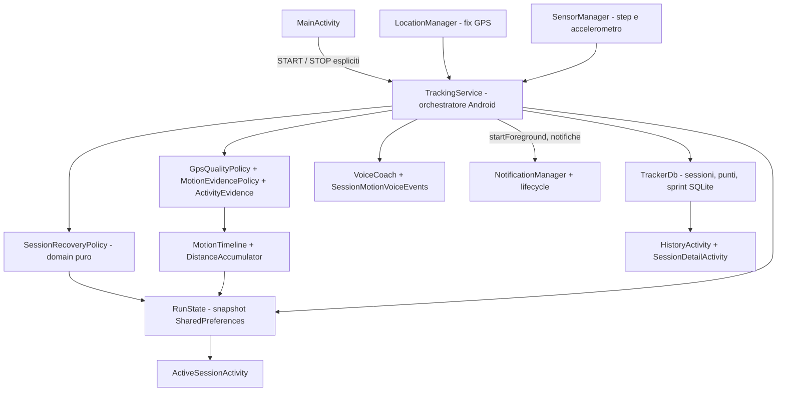

# Architettura PassoLibero (baseline main)

Questa descrizione riguarda il codice presente in `main` e il percorso incrementale della [issue #6](https://github.com/VittorioS/app-running/issues/6). PassoLibero V2 (PR #2) è già integrata; i prossimi refactor avvengono in PR autonome, dopo i test della issue #5.

## Flusso dati

`MainActivity` avvia esplicitamente `TrackingService` (foreground service). Il servizio riceve fix GPS e callback dei sensori e valuta attendibilità/attività tramite `GpsQualityPolicy`, `MotionEvidencePolicy`, `ActivityEvidence`, `MovementClassifier`, `InertialGaitDetector` e `StepCounterEvidence`. `MotionTimeline` contabilizza gli intervalli con timestamp monotoni. `DistanceAccumulator` filtra jitter e somma gli spostamenti attendibili. `RunState` è lo snapshot della sessione attiva, letto anche dalle attività. `TrackerDb` salva sessioni e punti in SQLite. `TrackMap` rappresenta i punti registrati su osmdroid. `ActiveSessionActivity`, `HistoryActivity` e `SessionDetailActivity` leggono e mostrano statistiche/storico. `VoiceCoach` gestisce gli annunci.

## Mappa di modifica

| Richiesta | Componenti da leggere | Verifiche particolari |
| --- | --- | --- |
| Classificazione / GPS / passi | TrackingService, MotionEvidencePolicy, MovementClassifier, MotionTimeline, StepCounterEvidence, DistanceAccumulator | prove vecchie, incerte, fuori ordine, stop/start e tempo conservato |
| Statistiche | RunStats, RunMath, RunState, ActiveSessionActivity | unità, unknown, totali e ripresa |
| Storico / campi persistenti | TrackerDb, RunState, SessionDetailActivity, HistoryActivity | nuove installazioni, migrazioni precedenti, dati preesistenti |
| Mappa e percorso | TrackMap, RouteSegmenter | intervalli GPS persi, memoria, offline e attribuzione OSM |
| Permessi / lifecycle | AndroidManifest.xml, MainActivity, TrackingService | foreground service, sensore assente, background e telefono reale |
| Build / APK / update | app/build.gradle, .github/workflows, ci/ | PR separata, credenziali solo in contesto trusted |

## Confini da mantenere

- I sensori e i componenti Android entrano dai controller; gli algoritmi non devono conoscere `Activity`, `LocationManager` o `SharedPreferences` quando non è necessario.
- Una UI non modifica direttamente la logica di classificazione per mostrare una nuova statistica.
- Una nuova metrica persistente richiede compatibilità tra `RunState`, `TrackerDb`, dettaglio storico e test.
- Mantieni la sessione originale e le coordinate sul dispositivo. La rete è necessaria solo per servizi online espliciti e tile OSM.
- La logica concentrata in `TrackingService` andrà estratta **incrementalmente con test** (non con un refactor di massa insieme a una feature).

## Regole architetturali per i nuovi contributi
Leggere [Clean Architecture](clean-architecture.md) e [Coding Standards](coding-standards.md) prima di introdurre nuove classi. Questa pagina descrive **l'architettura esistente**: i nuovi layer sono una direzione di migrazione, non una struttura già completata. Evitare refactoring di massa della logica GPS in una normale feature.

## Layout di repository

`app/src/main/java/it/example/passolibero/` codice app; `app/src/debug/` diagnostica solo debug; `tests/` regression test indipendenti da Android e verifiche SQLite; `app/src/test/` test locali eseguiti da Gradle; `.github/workflows/` build/verifica; `docs/` contratti e runbook.

## Responsabilità attuali di TrackingService — issue #6

| Responsabilità | Contratto da preservare | Confine previsto |
| --- | --- | --- |
| Avvio esplicito, permessi, `startForeground`, STOP / `onDestroy` | Nessun tracking senza azione utente o sessione preesistente; API 30 senza HEALTH type | `TrackingService` e futuri adapter `platform` |
| Callback `LocationManager`, `SensorManager` e relativi timestamp | Fix stale/futuri ignorati, niente sprint doppio, nessuna attività inventata | Adapter sensor/GPS futuri; policy pure già esistenti |
| Filtri GPS, classificatore, intervalli `UNKNOWN` | Nessun salto GPS, tempo monotono e ledger conservativo | `GpsQualityPolicy`, `MotionEvidencePolicy`, `MotionTimeline` |
| Ripartenza e tempo non osservato | Vecchi intervalli non dedotti come RUN, WALK o STILL; snapshot riletto senza cancellare dati | **`domain/SessionRecoveryPolicy` (prima estrazione)** |
| Persistenza `RunState` + `TrackerDb` | Snapshot periodici, id sessione, schema v7 e coordinate locali invariati | Adapter SQLite e SharedPreferences già esistenti |
| Annunci e sprint | Priorità TTS, countdown e ritmo GPS separato | `SessionMotionVoiceEvents`, `SprintTrial`, `VoiceCoach` |

### Piano di estrazione: PR autonome e revisionabili

1. **PR 1 — recupero puro del cronometro**: estrazione di `SessionRecoveryPolicy`, test di equivalenza con la vecchia formula, riavvio telefono e tempo `UNKNOWN`; nessuna modifica ai sensori o al database.
2. **PR 2 — decisioni di avvio/foreground**: `domain/ForegroundStartPolicy` isola le decisioni di permessi e tipo FGS e conserva il corto circuito della verifica GPS e la guardia HEALTH su API 34+; test JVM e instrumentation API 30. L'ordine dei side effect di avvio/STOP resta nel servizio.
3. **PR 3 — confine GPS/sensori**: spostare una decisione per volta dai callback in adapter/policy puri, con replay dei fix tardivi e dei batch contapassi della suite #5; **solo dopo** valutare un'orchestrazione ulteriore, senza cambiare sampling o stato persistito.

Ogni PR richiede `verify` e `android11` verdi; sono vietate modifiche di schema, soglie GPS, temporizzazioni, permessi, firma o annunci nella stessa estrazione.
