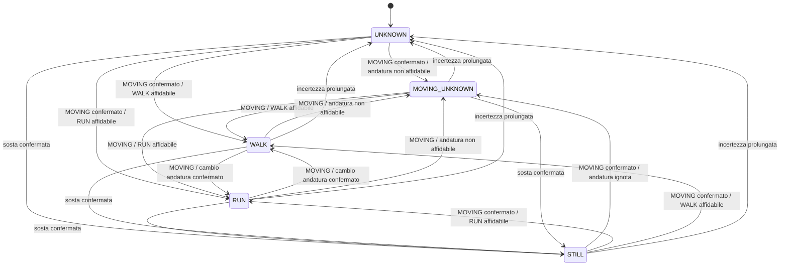

# Rilevamento del movimento, statistiche e preferenze

**Implementazione:** `MotionEvidencePolicy`, `MotionTimeline`, `ActivityEvidence`, `MovementClassifier`, `StepCounterEvidence`, `InertialGaitDetector`, `DistanceAccumulator`, `GpsQualityPolicy`, `RunState`, `SessionTabStats`, `AppPrefs`, `TrackingService`.

## Distinguere prove da categorie

| Dimensione | Valori nel codice | Significato |
| --- | --- | --- |
| Prove | `MOVING`, `STILL_STRONG`, `STILL_MODERATE`, `UNCERTAIN` | Risultato della valutazione GNSS, passi, accelerometro, timestamp |
| Movimento confermato/visibile | `RUN`, `WALK`, `MOVING_UNKNOWN`, `STILL`, `UNKNOWN` | Categoria dell'intervallo e stato mostrato |
| Schede UI | `RUN`, `WALK`, `TOTAL`, `SPRINT` | Proiezione delle statistiche, non modifica il classificatore |
| Qualità GPS | attendibile, impreciso, assente, in ritardo | Valutazione distinta dalla categoria di movimento |

**`MOVING_UNKNOWN` non equivale a `UNKNOWN`**: il primo accredita movimento certo, ma non una specifica andatura; il secondo contabilizza tempo non sufficientemente osservato.

Questo schema **astrae i tempi pending**: `MotionTimeline` può trattenere il precedente stato visibile mentre conferma movimento/sosta e accredita i relativi intervalli secondo il ledger. Non è una transizione immediata al primo fix.

## Transizioni e prove

| Stato / contesto | Evento o condizione | Guardia | Esito ed effetto |
| --- | --- | --- | --- |
| Qualunque | Fix GNSS | accuratezza assente, <=0, >25 m o età >10 s | scarta come fonte affidabile; non inventa distanza |
| Qualunque | Fix fuori ordine / futuro / obsoleto | timestamp non monotono o misura non fresca | non aggiorna classificazione/distanza; reset filtri dove previsto |
| UNKNOWN / STILL | MOVING | movimento confermato nel tempo | WALK/RUN soltanto con andatura affidabile, altrimenti MOVING_UNKNOWN |
| RUN / WALK | MOVING ma andatura non più stimabile | persiste prova di movimento | MOVING_UNKNOWN, nessuna categoria inventata |
| Movimento | STILL_STRONG / STILL_MODERATE | stop stabile oltre soglia effettiva | STILL; contabilizza stop pending retrodatato alla prima prova forte |
| Movimento | sosta candidata seguita da MOVING | stop non ancora confermato | revoca stop pending, accredita all'attività precedente |
| Qualunque | UNCERTAIN | evidenza insufficiente | non conferma STILL; alla scadenza della tolleranza l'intervallo diviene UNKNOWN |
| Sosta pending | batch Step Counter tardivo | ultimo step sovrapposto allo stop pending | revoca sosta; intervallo incerto, nessuna ricostruzione dei passi intermedi |
| Qualunque | Intervallo senza callback significativo | worker sospeso / lungo gap | intervallo non osservato -> UNKNOWN; non retro-classificare |
| Qualunque | Sessione terminata | stop pending o tempo unresolved | risolve pending come UNKNOWN e chiude il ledger |

Regole rilevanti: GNSS per `MotionEvidencePolicy` fresco entro **2,5 s** per stimare attività; l'attendibilità più ampia del fix (`GpsQualityPolicy`: accuratezza <=25 m, età <=10 s) **non** autorizza da sola una nuova andatura. Se il detector è assente, prova Step Counter o accelerometro come fallback; un'accelerazione irregolare o una contraddizione con GNSS lento non prova corsa/camminata. Lo stop è confermato con soglie diverse per evidenza e fonte (con Step Counter cumulativo almeno **12 s**); non promettere sosta al primo istante senza passi.

## Ledger e metriche

| Misura | Contratto |
| --- | --- |
| `movingMs` | `runMs + walkMs + movingUnknownMs` |
| `elapsedMs` finale | coerente con `runMs + walkMs + movingUnknownMs + stillMs + unknownMs` dopo la risoluzione dei pending |
| `distanceM` | distanza accumulata da fix accettati con anti-drift/anti-salto; non attribuire automaticamente tutta la distanza a RUN/WALK |
| `runM` / `walkM` | delta di distanza attribuiti solo alla categoria confermata corrispondente |
| `TOTAL` (tab) | somma **solo** RUN e WALK per distanza, durata e passi attribuiti; non è il totale cronologico della sessione |
| `SPRINT` (tab) | prove separate da `SprintTrial`, non somma/ridefinizione delle categorie ordinarie |
| Ritmo | min/km; senza distanza/tempo sufficienti UI mostra trattini, non una stima fittizia |
| Velocità istantanea in dettaglio storico | indisponibile (trattini), non zero: non è salvato uno snapshot istantaneo finale |
| Velocità massima RUN | solo con corsa confermata, GPS recente/affidabile e delta valido; assenza dati -> `null`/trattini |

## Preferenze, checkpoint e obiettivi

| Controllo | Valori / comportamento attuale |
| --- | --- |
| Soglia manuale corsa/cammino Home | da **3 a 12 km/h**, incrementi **0,5 km/h**, default **6 km/h** |
| Classificazione adattiva | switch default attivo; profilo **locale**, campioni supervisionati RUN/WALK per **30 s** dai pulsanti delle rispettive tab, solo quando la prova è adatta |
| Annunci vocali checkpoint | switch Home default attivo; checkpoint **250 / 500 / 1000 / 2000 / 5000 m**, default 1000 |
| Cambio intervallo checkpoint | ricalcola indice già raggiunto rispetto alla distanza corrente; non riproduce annunci per checkpoint passati |
| Obiettivo | nessuno, 1/2/3/5/10/21,097 km oppure personalizzato **0,1–200 km**; progresso e metri rimanenti |
| Tab Corsa / Cammina / Totali | sole statistiche selezionate; cambio tab non altera classificazione o contabilità |
| Selezione tab al ritorno | può seguire una classificazione recente RUN/WALK o sprint attivo; scelta manuale prevale per l'apertura |

Il servizio salva anche `checkpointIndex` **prima** dell'annuncio per evitare doppia lettura dopo crash. Annunci di sprint e avvisi GPS hanno condizioni/priorità diverse dal semplice interruttore checkpoint: non descrivere lo switch voce come silenziamento totale di ogni evento TTS.

## Casi limite e tracciabilità

- GPS perso, salti e lungo gap **non** generano un segmento fittizio o un incremento arbitrario.
- Su alcune configurazioni mancano step detector, counter o `ACTIVITY_RECOGNITION`: tempi e GPS restano utili, passi/cadenza degradano.
- Il marker live non deve saltare per puro jitter senza distanza credibile.
- Fonti: [invarianti](../invariants.md), `tests/MotionRegressionTest.java`, `tests/TrackingReplayTest.java`, `app/src/test/.../Movement*` e test di caratterizzazione delle policy pure in `domain/tracking`.
