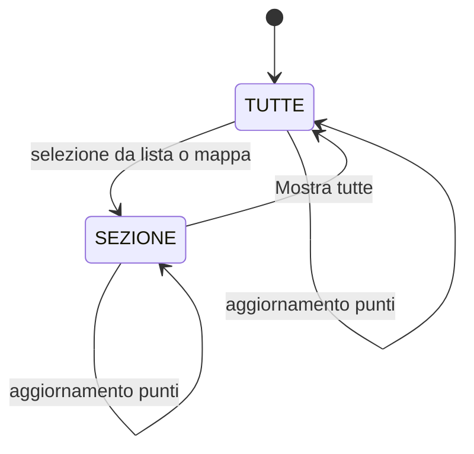
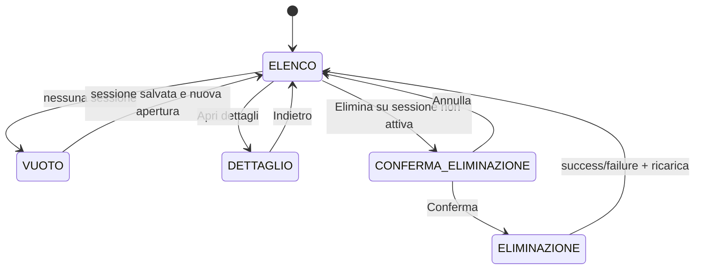
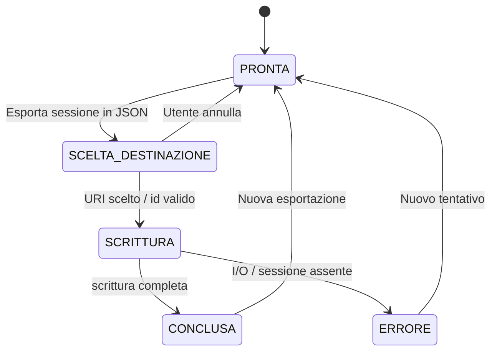

# Mappa, sezioni, storico ed esportazione JSON

**Implementazione:** `TrackMap`, `RouteSections`, `RouteSectionList`, `RouteSectionSelection`, `RouteSegmenter`, `HistoryActivity`, `SessionDetailActivity`, `HistoryDataBridge`, `SqliteSessionDeleteAdapter`, `SessionJsonExporter`, `TrackerDb`.

## Mappa live e storica

| Contesto | Cosa viene mostrato | Origine dati | Vincoli |
| --- | --- | --- | --- |
| Sessione attiva | Posizione attuale e **solo** percorso della sessione corrente | `RunState` + punti SQLite della sessione | Il marker è presentato solo dopo una posizione valida; la mappa segue inizialmente il GPS |
| Dettaglio storico | Punti e sezioni salvate della sessione selezionata | SQLite `points` e `sprints` | Nessuna posizione live; zoom sul tracciato, esplorazione manuale |
| Tessere della mappa | OpenStreetMap/osmdroid | tile server HTTPS OSM e cache locale | Senza rete nuove tessere potrebbero non apparire; il tracciato rimane locale |

Le sezioni WALK (verde), RUN (blu), SPRINT (rosso) e fermo/incerto (grigio) raggruppano i punti di percorso. Una sezione selezionata resta evidenziata, le altre vengono attenuate; selezione da lista e da mappa si sincronizzano; "Mostra tutte" ripristina la visualizzazione. Un gap prolungato o salto GPS non deve essere disegnato come segmento di percorso valido. Gli orari e valori mostrati per una singola sezione sono **stime derivate dai punti GPS**, non necessariamente identici ai totali di sessione.

### Stato di selezione della mappa

| Stato | Evento | Guardia | Risultato |
| --- | --- | --- | --- |
| TUTTE | Tap sezione mappa/lista | sezione presente | SEZIONE; evidenzia tratto, presenta dati |
| SEZIONE | Tap altra sezione | numero valido | SEZIONE nuova; evidenzia solo scelta |
| SEZIONE | Mostra tutte | — | TUTTE; ripristina colori e, se live, inseguimento GPS |
| TUTTE / SEZIONE | Nuovi punti live | sessione attiva | aggiorna solo sessione corrente senza incrociare sessioni |
| Qualunque | GPS non affidabile / interruzione | gap o salto | non aggiunge linea geometrica fittizia |

## Storico: navigazione e cancellazione

Gli stati sono proiezioni della **UI**; SQLite distingue sessioni `IN_PROGRESS` e `COMPLETED`.

| Vista | Evento | Guardia | Effetto |
| --- | --- | --- | --- |
| Storico | Apertura/ritorno | lettura SQLite OK | elenca sessioni per data, distanza, durata, ritmo, passi e stato |
| Storico | Lettura fallita | errore DB | messaggio di errore, nessun dato inventato |
| Elenco | Apri dettagli | id sessione selezionato | apre statistiche, percorso, sprint e esportazione |
| Elenco | Elimina | `active=true` e `active_id == id` | bottone disabilitato; non eliminare sessione live |
| Elenco | Elimina | sessione non attiva | dialogo esplicito irreversibile |
| Conferma | Annulla | — | nessuna modifica |
| Conferma | Conferma | id valido, non attivo anche al momento della transazione | tenta cancellazione della riga sessione e figli `points`/`sprints` in **un'unica transazione** |
| Eliminazione | Successo | commit transazione | notifica e ricarica; sessione e figli assenti |
| Eliminazione | Errore / concorrenza | transazione non completata | non dichiarare successo; rollback e feedback |

In `HistoryActivity`, mentre una cancellazione è in corso lo stesso id è nel set `deleting` e la UI disabilita il pulsante. Nel dettaglio storico le velocità istantanee non persistite vengono mostrate come **non disponibili**, non come 0.

## Esportazione JSON: ciclo di vita

| Stato | Evento | Guardia | Risultato |
| --- | --- | --- | --- |
| PRONTA | Tap export | id > 0 | Android `ACTION_CREATE_DOCUMENT`, MIME `application/json` |
| SCELTA_DESTINAZIONE | Annullamento / URI nullo | — | nessun export |
| SCELTA_DESTINAZIONE | Conferma destinazione | URI valido | SCRITTURA su thread dedicato, UTF-8 |
| SCRITTURA | Fine I/O | writer completato | toast "Sessione esportata in JSON" |
| SCRITTURA | Eccezione | file non accessibile / sessione non trovata | toast errore, successo non dichiarato |

Formato corrente: `format=passolibero-session`, `schema_version=1`; id, status, timestamp, `totals`, `running`, `walking`, `classified_total`, `unclassified`, `sprints` e `gps_points`. Esporta coordinate GPS **precise** della sessione scelta: il file viene creato nella destinazione indicata dall'utente tramite Android, **non** caricato automaticamente in rete. I dati esportati possono essere condivisi successivamente dall'utente; trattarli come sensibili.

## Persistenza e conservazione

`TrackerDb` usa `sessions.db` schema **v7** con tabelle `sessions`, `points` e `sprints`; migrazioni incrementali da versioni precedenti senza drop della cronologia. I campi storici opzionali (passi attribuiti, checkpoint, velocità max) possono essere `NULL`: non trasformarli in falsi valori misurati. La cancellazione intenzionale su conferma è distinta dalle migrazioni, che conservano i dati.

Test: `HistoryDeleteConfirmationInstrumentedTest`, `HistoryDeleteUiInstrumentedTest`, `TrackerDbDeleteCharacterizationTest`, `SessionJsonGpsExportCharacterizationTest`, `tests/check-db-migration.py`.
