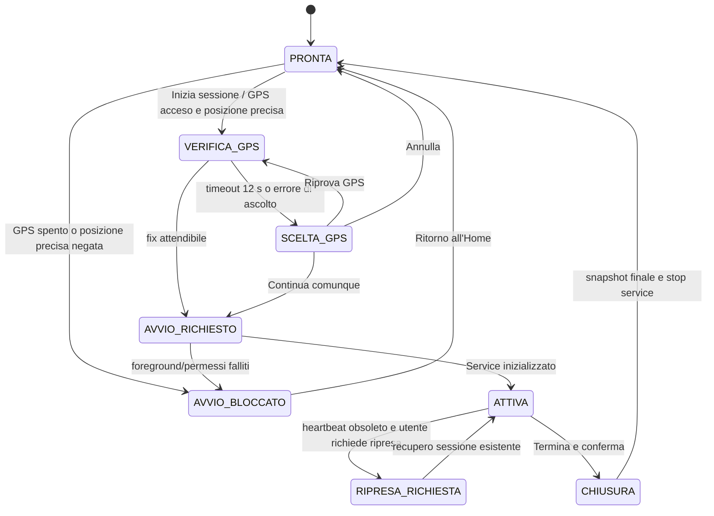

# Sessione — lifecycle, avvio e navigazione

**Implementazione di riferimento:** `MainActivity`, `TrackingService`, `TrackingStartupCoordinator`, `SessionEntryCoordinator`, `SessionRecoveryPolicy`, `RunState`, `TrackerDb`, `ActiveSessionActivity`.

## Stato di sessione e stati di UI

Lo stato durevole è `active` + `active_id` (SharedPreferences), con riga SQLite `sessions.status` (`IN_PROGRESS` oppure `COMPLETED`). Il seguente Statechart rappresenta l'**esperienza funzionale**, non un enum unico del codice:

`AVVIO_BLOCCATO` e `RIPRESA_RICHIESTA` sono stati di interazione rappresentativi: il codice non li salva come enum. In caso di distruzione non prevista del servizio, la sessione può rimanere `active=true` e riprendere in una successiva inizializzazione.

## Tabella delle transizioni

| Stato di partenza | Evento | Guardia / discriminante | Stato / effetto osservabile |
| --- | --- | --- | --- |
| PRONTA | Tap "Inizia" | GPS disattivato | AVVIO_BLOCCATO; dialogo per le impostazioni posizione, nessuna nuova sessione |
| PRONTA | Tap "Inizia" | permesso `ACCESS_FINE_LOCATION` non concesso | richiesta permessi; se ancora negato, toast e nessun avvio |
| PRONTA | Tap "Inizia" | GPS attivo, posizione precisa concessa | VERIFICA_GPS; registrazione GPS temporanea, massimo 12 s |
| VERIFICA_GPS | Fix GPS | accuratezza `0 < a <= 25 m`, età `0..10 s` | AVVIO_RICHIESTO; invio START |
| VERIFICA_GPS | Timeout/errore richiesta GPS | nessun fix affidabile | SCELTA_GPS; Continua / Riprova / Annulla |
| SCELTA_GPS | Continua comunque | scelta utente | AVVIO_RICHIESTO anche senza fix affidabile nel preflight |
| SCELTA_GPS | Riprova / Annulla | scelta utente | nuova verifica / nessun avvio |
| AVVIO_RICHIESTO | START del service | GPS abilitato e permesso preciso presenti; FGS acquisibile | nuova riga `sessions`, `active=true`, campionamento e notifiche |
| AVVIO_RICHIESTO | START del service | prerequisiti service falliti | errore salvato, `stopSelf`, nessuna partenza riuscita |
| ATTIVA | Tap "Inizia" da Home | flag `active=true` | apre sessione corrente; non crea una seconda riga |
| ATTIVA | Tap "Termina" | dialogo annullato | ATTIVA, senza STOP |
| ATTIVA | Tap "Termina" | conferma | CHIUSURA; STOP, snapshot SQLite `COMPLETED`, `active=false`, rimozione foreground |
| ATTIVA | Service distrutto inaspettatamente | esiste sessione attiva | snapshot di recupero, **non** completamento automatico; flag attivo mantenuto |
| ATTIVA | Home rileva heartbeat vecchio | `nowWall - heartbeat_wall > 15 s` | mostra "Riprendi tracciamento interrotto" |
| RIPRESA_RICHIESTA | START | `active=true` e `active_id>0` | riusa sessione; movimento riparte `UNKNOWN`, periodo non osservato va in `unknownMs` |
| Qualunque | STOP anticipato | stato runtime assente ma `active=true` | rilegge snapshot e tenta chiusura; senza `active` termina service |
| ATTIVA | Ritorno Home / schermo spento | nessun STOP | ATTIVA; il servizio possiede il tracking, non la schermata |

La Home richiede anche `ACTIVITY_RECOGNITION` e `POST_NOTIFICATIONS` quando mancanti, ma **il permesso essenziale per avviare è la posizione precisa**. La disponibilità dei passi dipende dal permesso e dall'hardware. Android può rifiutare comunque l'avvio del foreground service; non è promesso un avvio infallibile.

## Effetti e invarianti

- `TrackingService` usa un worker dedicato, foreground notification e sensori soltanto durante la sessione; tick circa ogni secondo, snapshot SQLite circa ogni 5 s e a chiusura.
- Una ripresa legge `RunState` da preferenze, riallinea il clock e marca non osservato come `UNKNOWN`. Non collega geometricamente due fix separati dal riavvio.
- `ActiveSessionActivity` mostra inizializzazione in attesa di `active`; quando una sessione già vista passa a inattiva chiude la schermata. Non è la proprietaria del ciclo di vita del tracciamento.
- La chiusura salva statistiche e percorso nello storico; non cancella il passato. La presenza di `IN_PROGRESS` nello storico indica sessione non conclusa, non una prova che il service sia in esecuzione.
- Lo START viene normalmente lanciato dalla Home dopo preflight; un Intent `null`/sconosciuto nel service segue il percorso START/riavvio per compatibilità con `START_STICKY`.
- Non sono documentate come garantite tempistiche esatte di ripartenza dopo terminazione del processo Android o riavvio del dispositivo.

## Casi di verifica

Test e riferimenti: `TrackingLifecycleEntryCharacterizationTest`, `TrackingServiceDeniedStartInstrumentedTest`, `TrackingServiceEarlyStopInstrumentedTest`, `TrackingPersistenceInstrumentedTest`, `tests/SessionRecoveryPolicyTest.java`, `docs/invariants.md`.
