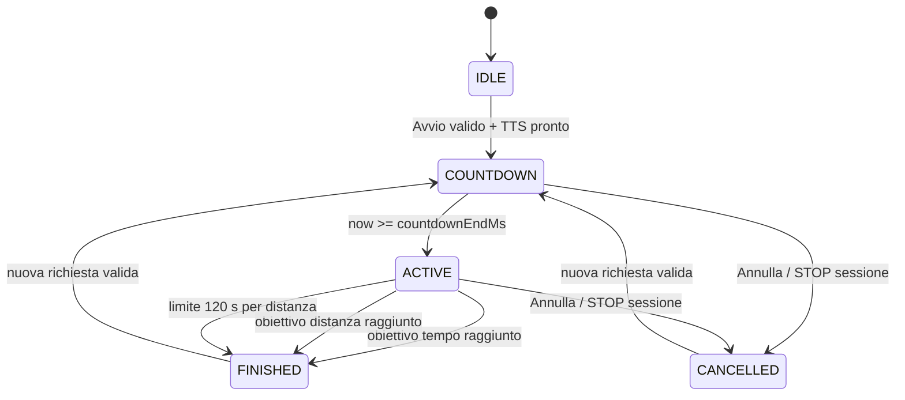

# Sprint — Statechart e transizioni

**Implementazione:** `ActiveSessionActivity`, `TrackingService`, `SprintTrial`, `SprintCountdownVoicePlan`, `SprintProgressVoicePlan`, `TrackerDb.recordSprint`.

Sprint è una prova **volontaria separata dal classificatore RUN/WALK** della sessione: il suo tracciato può avere etichetta `SPRINT:<timestamp>`, ma il rilevamento ordinario mantiene la propria frequenza e le proprie metriche. Serve una sessione attiva.

## Due dimensioni da non confondere

- **Preparazione UI/TTS:** `NESSUNA -> VOCE_IN_PREPARAZIONE -> PRONTO_PER_COUNTDOWN` oppure `ERRORE/ANNULLATO`. `VOCE_IN_PREPARAZIONE` è un flag di preferenze (`sprint_voice_preparing`), non una fase dell'oggetto `SprintTrial`.
- **Modello SprintTrial:** `IDLE`, `COUNTDOWN`, `ACTIVE`, `FINISHED`, `CANCELLED`. Dopo `FINISHED/CANCELLED` una nuova richiesta valida può avviare un nuovo countdown, mantenendo gli sprint già salvati.

Il **passaggio richiesta -> COUNTDOWN** passa prima per la preparazione TTS: il codice attende la voce italiana pronta fino a 5 s. Se non disponibile, **non** fa partire uno sprint silenzioso a sorpresa.

## Tabella di transizione

| Fase | Evento | Guardia | Nuova fase / effetto |
| --- | --- | --- | --- |
| IDLE / FINISHED / CANCELLED | Start sprint | sessione attiva, non busy, countdown 5–10 s, durata 5–120 s **oppure** distanza 10–500 m | prepara TTS, disabilita i controlli durante la preparazione |
| VOCE_IN_PREPARAZIONE (UI) | TTS pronto | prima della scadenza 5 s e richiesta ancora valida | `COUNTDOWN`; parte piano vocale, richiesta GPS fino a 200 ms |
| VOCE_IN_PREPARAZIONE (UI) | Timeout TTS | voce non pronta entro 5 s | resta senza prova attiva; errore `sprint_voice_error`, possibile nuovo tentativo |
| VOCE_IN_PREPARAZIONE (UI) | Annulla | richiesta pendente | scarta preparazione e ferma eventuale parlato |
| COUNTDOWN | Tick | tempo monotono >= fine countdown | ACTIVE; annuncio "Via, sprint" se voce pronta |
| COUNTDOWN / ACTIVE | Annulla / STOP sessione | prova busy | CANCELLED; risultato registrato una sola volta |
| ACTIVE, modalità TIME | Tick | tempo >= inizio + target secondi | FINISHED con esito `TEMPO` |
| ACTIVE, modalità DISTANCE | Fix GNSS accettato | distanza integrata >= target metri | FINISHED con esito `DISTANZA` |
| ACTIVE, modalità DISTANCE | Tick | tempo >= inizio + 120 s | FINISHED con esito `LIMITE_TEMPO` |
| ACTIVE | Fix scaduto, fuori ordine o impreciso | fallisce i criteri GNSS | ignorato; non aumenta distanza né contatore campioni |
| COUNTDOWN / ACTIVE | Nuovo Start | prova già busy o voce pending | ignorato dal servizio |
| FINISHED / CANCELLED | Nuovo Start valido | voce pronta | nuova prova, gli esiti precedenti restano in `sprints` |
| Qualunque | Ricreazione del service | ripristino sessione preesistente | sprint runtime azzerato a IDLE; non riprende sprint precedente |

## Contratti di misura e dati

- Input: countdown **5–10 s**, target tempo **5–120 s** oppure distanza **10–500 m**.
- In modalità DISTANCE, limite durata **120 s** anche se il target non viene raggiunto.
- Vengono considerati solo fix con timestamp >= inizio prova e non futuro, età <= **1,8 s**, accuratezza posizione <= **12 m**, accuratezza velocità <= **1,5 m/s**, velocità GNSS tra **0 e 40 km/h**. Un fix deve essere più nuovo del precedente; gap > **2,5 s** non viene integrato come tratto continuo.
- Distanza sprint stimata integrando velocità GNSS valide su intervalli brevi. Velocità media mostrata solo quando ci sono almeno **2 campioni validi**, durata positiva e distanza >0; altrimenti trattini. Non è un cronometro sportivo certificato.
- Durante countdown/ACTIVE si richiede al GNSS un intervallo fino a **200 ms**, **non garantito** dal telefono. Campionamento generale classificazione RUN/WALK continua a circa 1 Hz; punti sprint non devono raddoppiare il totale generale.
- `TrackingService` pubblica un riepilogo sprint in SharedPreferences per la UI e scrive nella tabella SQLite `sprints` esiti conclusi/annullati con target, durata, distanza, campioni, velocità media/massima ed esito. La tab Sprint mostra anche l'elenco delle prove della sessione.
- Un avvio sprint può essere respinto dal servizio senza creare prova (parametri invalidi o servizio non inizializzato). La UI è una proiezione del flag e della fase persistiti, non una conferma di avvio al solo tap.

Tracciabilità: `SprintTrial.java`, `TrackingService.onStartCommand` / `advanceSprint`, `ActiveSessionActivity.renderSprint`, `app/src/test/.../Sprint*`, test strumentali di persistenza e voce.
