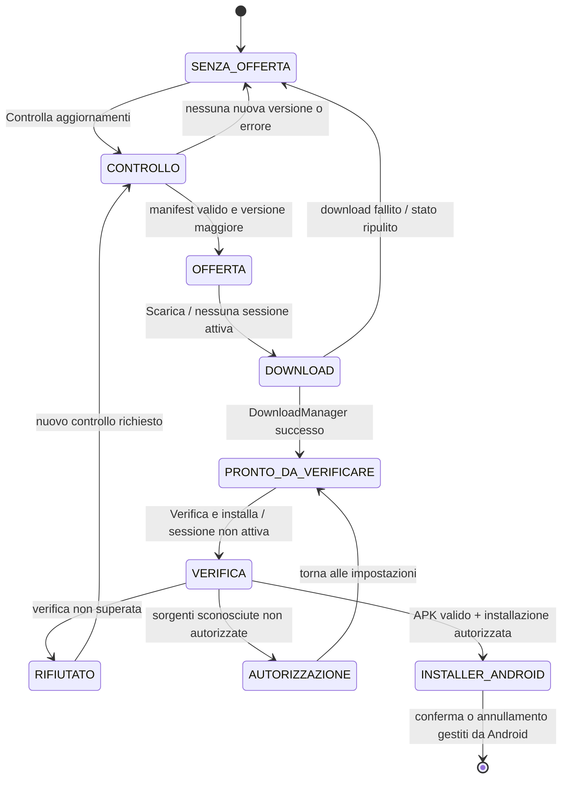

# Aggiornamenti in-app — stati, sicurezza e installazione

**Implementazione:** `UpdateActivity`, `UpdateManager`, `UpdatePolicy`, `RestoreSavedDownload`, `ReadDownloadState`, `DownloadPollingViewState` e adapter GitHub/Android.

La verifica dell'APK avviene sul dispositivo. **L'app non installa APK in silenzio**: apre il flusso di conferma Android. Non confondere canale disponibile nell'UI con disponibilità effettiva di una release.

## Canali e condizioni globali

- Canali selezionabili: `debug` (tag `debug-pr-2`) e `stable` (tag `stable`) da repository GitHub del progetto; il manifest `update.json` e il nome dell'APK sono attesi secondo una policy deterministica.
- Un'offerta è valida solo se schema, package, canale, filename, SHA-256, certificate SHA-256 e versione sono coerenti; la versione proposta deve avere `versionCode` **maggiore** di quella installata.
- L'installazione è inibita se `active=true`: **mai interrompere una sessione per aggiornare**. Il blocco viene ricontrollato anche dopo la verifica asincrona.
- Prima di aprire l'installer si verificano file, dimensione, SHA-256 dell'APK, package, versionCode e identità del firmatario coerente con installazione e manifest; fail-closed.
- Android può richiedere l'autorizzazione all'installazione da questa sorgente. La conferma finale dipende dall'utente e dal sistema.

## Stato del flusso

Gli stati rappresentano **l'esperienza funzionale**. I dettagli del download sono restituiti da `ReadDownloadState` e proiettati da `DownloadPollingViewState`; non tutti sono enum persistiti in `UpdateActivity`.

| Stato | Evento | Guardia | Effetto |
| --- | --- | --- | --- |
| SENZA_OFFERTA | Cambio canale | debug/stable | azzera offerta corrente; tenta ripristino di download salvato compatibile |
| SENZA_OFFERTA | Controlla | nessun check già in corso | CONTROLLO su thread separato |
| CONTROLLO | Manifest 404 / build non più recente | — | nessuna offerta |
| CONTROLLO | Manifest invalido / rete fallita | errore | messaggio di errore, nessuna offerta installabile |
| CONTROLLO | Offerta valida | versione maggiore | OFFERTA; pulsante download attivo solo se sessione non attiva |
| OFFERTA | Scarica | sessione non attiva | enqueuing tramite DownloadManager, salva id/canale/versione/hash |
| OFFERTA | Scarica | sessione attiva | blocca l'operazione e mostra messaggio |
| DOWNLOAD | Completamento/fallimento | stato DownloadManager | pronto per verifica oppure errore/ripristino dello stato |
| PRONTO_DA_VERIFICARE | Verifica | sessione non attiva | VERIFY su thread dedicato |
| VERIFICA | Digest/package/versione/firma non validi | un controllo fallisce | RIFIUTATO, azzera metadati download, nessun installer |
| VERIFICA | APK valido | sessione divenuta attiva | installer bloccato, messaggio "aggiorna dopo" |
| VERIFICA | APK valido, installazione non autorizzata | `canRequestPackageInstalls=false` | apre impostazioni Android e richiede nuovo tap |
| VERIFICA | APK valido e installazione autorizzata | sessione inattiva | Intent Android verso URI `content://` dell'APK |
| Qualunque | Pausa/ripresa Activity | download salvato | sospende/riprende polling; **non** equivale a interrompere DownloadManager |

## Invarianti di sicurezza

1. Non accettare URL di APK arbitrari dal manifest: origine, tag e filename sono derivati da allowlist.
2. SHA-256 dell'APK **e** digest del certificato sono controllati, oltre all'identità del firmatario installato. Un digest dichiarato dal server senza confronto con la firma installata non basta.
3. Se un controllo fallisce, **non** tentare installazione. Non dichiarare che Android abbia installato il pacchetto soltanto perché si è aperta l'Activity dell'installer.
4. Preservare `sessions.db`: non disinstallare un APK con firma diversa; non modificare chiavi di firma o pipeline di release in una feature/documentazione.
5. La disponibilità reale di `debug-pr-2` o `stable` dipende dalle release presenti su GitHub; il codice supporta i canali, non ne garantisce l'esistenza.

Test: `UpdateManifestFailClosedInstrumentedTest`, `UpdateDownloadFailClosedInstrumentedTest`, `UpdateVerificationGuardInstrumentedTest`, `UpdateSignerPolicyInstrumentedTest`, `SavedDownloadPreferencesAdapterInstrumentedTest`, `UpdateApkSha256InstrumentedTest`, [release runbook](../release.md).
