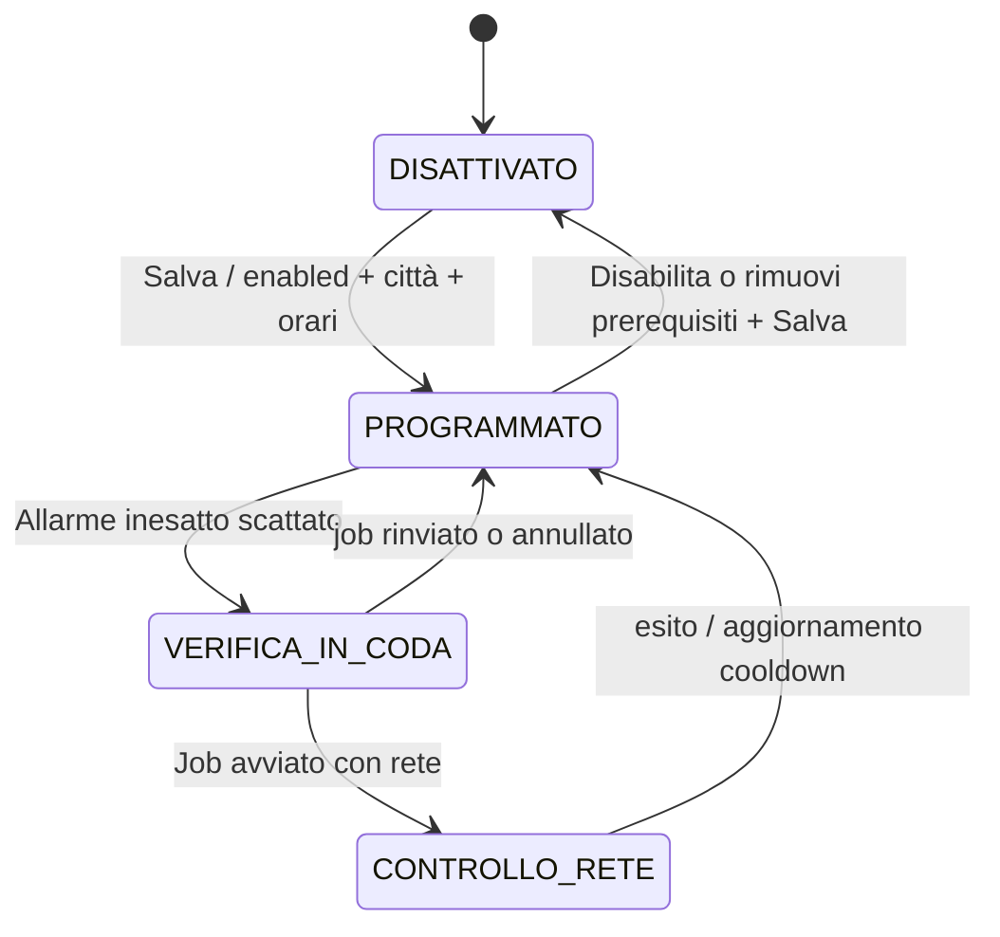

# Meteo per correre — impostazioni, preview e avvisi

**Implementazione:** `WeatherSettingsActivity`, `WeatherLocations`, `WeatherRules`, `WeatherSchedule`, `WeatherMonitor`, `WeatherAlarmReceiver`, `WeatherTimeReceiver`, `WeatherJob`, `WeatherApi` e adapter Open-Meteo.

Il servizio meteo è una funzione **online opzionale**, distinta dal tracking GPS. L'utente cerca e seleziona manualmente le città: non viene acceso il GPS in background per individuarle.

## Configurazione

- Da **0 a 20 città**, deduplicate per latitudine/longitudine esatte; ricerca per nome (almeno 2 caratteri) e selezione del risultato con città/regione/Paese.
- Criteri opzionali in **AND**: temperatura minima **-90..65 °C**, temperatura massima **-90..65 °C** (min <= max), vento massimo **0..300 km/h**. Campo vuoto = assenza del vincolo; **zero è valido**. Dati previsionali non finiti non devono mai generare avvisi.
- Orari giornalieri del telefono nel formato locale `HH:mm`, distinti e ordinati. Nessun orario => nessun controllo automatico, ma la **preview manuale** resta disponibile.
- `weather_enabled`, almeno una città e almeno un orario sono tutte condizioni necessarie per `WeatherMonitor.isActive`. Se si prova a salvare con switch attivo e città/orari mancanti, la UI mostra un errore e non salva quella configurazione.
- La preview usa la **lista presente nella schermata**; quando cambia la lista, i risultati precedenti sono invalidati. Richieste di ricerca/preview superate da un'altra richiesta non devono sovrascrivere la UI corrente.

## Statechart degli avvisi

"Verifica in coda" e "Controllo rete" sono stati **concettuali di scheduling**, non un enum persistito. `AlarmManager` programma una sola prossima occorrenza; alla ricezione dell'allarme programma la successiva e richiede un `JobScheduler` con connettività. Doze, assenza di rete e politiche Android possono ritardare o impedire l'esecuzione prevista: **non è un controllo exact-alarm**.

| Stato/contesto | Evento | Guardia | Effetto |
| --- | --- | --- | --- |
| DISATTIVATO | Salva configurazione | switch ON + >=1 città + >=1 orario + regole valide | PROGRAMMATO; conserva preferenze, calcola prossimo allarme locale |
| Qualunque | Salva regole invalide | limiti non validi / min > max / non numerico | errore UI; non riprogramma |
| PROGRAMMATO | Salva switch OFF / lista o orari non più validi | — | cancella allarme/job esistenti, DISATTIVATO |
| PROGRAMMATO | Allarme `CHECK_WEATHER` | configurazione ancora attiva | riprogramma prossimo allarme, accoda job con rete |
| VERIFICA_IN_CODA | Job eseguito | rete e configurazione ancora valida | consulta una per una le città correnti |
| CONTROLLO_RETE | Previsione favorevole | criteri in AND, slot non scaduto, entro 6 h, slot diverso e cooldown >=6 h | notifica locale per quella città; salva orario e slot notificati |
| CONTROLLO_RETE | Previsioni sfavorevoli / non valide | — | nessuna notifica |
| CONTROLLO_RETE | Errore per una città | altre città disponibili | continua le altre; errore totale rimandato se nessuna richiesta riuscita |
| PROGRAMMATO | Riavvio, cambio ora/fuso, aggiornamento APK | broadcast Android ricevuto | ricostruisce il prossimo allarme |
| Qualunque | Preview manuale | >=1 città e regole valide | richiesta online e report per città; indipendente dagli orari automatici |
| Preview in corso | Nuova preview / modifica città | seriale della vecchia richiesta superato | ignora il vecchio risultato UI |

`WeatherRules.shouldNotify` richiede slot previsionali con `slot+3600 > now` e `slot <= now+6h`, diverso dall'ultimo slot notificato; il cooldown di **6 ore è indipendente per città**. Non promettere una notifica esattamente ogni 6 ore: le condizioni meteo possono non corrispondere e l'esecuzione di Android è differibile. Su API >=33 serve anche `POST_NOTIFICATIONS` per notificare.

## Privacy, disponibilità e dipendenze

La ricerca invia testo della località a Open-Meteo; la previsione invia le coordinate **delle città scelte**, non il tracciato della sessione. Senza rete non sono disponibili dati aggiornati, ma le sessioni GPS rimangono autonome. Gli orari sono locali al telefono, non necessariamente al fuso della città monitorata.

Test: `WeatherRulesTest`, `WeatherCitySearchAdapterInstrumentedTest`, `WeatherForecastAdapterInstrumentedTest` e test di scheduling in `tests/` e `app/src/test/`.
