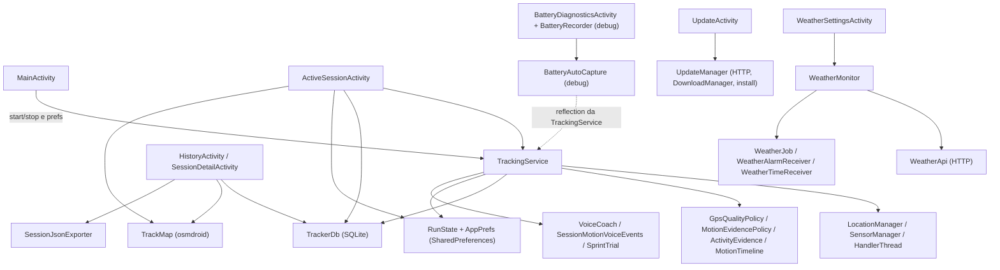

# Mappa delle dipendenze — baseline per ADR-002

**Stato:** inventario di progettazione, non una mappa statica esaustiva degli import.

**Baseline:** `main` @ `14effdeb6b8909a8e3110c3e432ee25e82d168a4` (2026-11-09). Nell'applicazione Java di produzione risultano 50 file `src/main`: 47 nel package legacy radice, 3 policy in `domain`. La source set `src/debug` ha `BatteryAutoCapture.java` e `BatteryDiagnosticsActivity.java` (il secondo contiene anche `BatteryRecorder`). Nel modulo singolo `app` vi sono test JVM in `tests/`, test Gradle `app/src/test/` e instrumentation in `app/src/androidTest/`.

## 1. Flussi osservati oggi



Le frecce sono **relazioni architetturali semplificate** ricavate dalla lettura dei file: non rappresentano ogni chiamata o import. In particolare l'arco di reflection reale è `TrackingService` che cerca il nome `BatteryAutoCapture` in `BuildConfig.DEBUG`; la freccia tratteggiata evidenzia la dipendenza, non il verso esatto della chiamata.

## 2. Responsabilità correnti → destinazione proposta

| Sottosistema / classi | Dipendenza problematica oggi | Confine/posizione desiderata | Trappole da controllare |
| --- | --- | --- | --- |
| `TrackingService` (~973 righe), `MainActivity` | Service combina lifecycle Android, state mutation, persistenza e segnali | `platform/service` + `application/tracking` + policy `domain` | `START_STICKY`, STOP prima di init, service destroy, callback Looper |
| `GpsQualityPolicy`, `MotionEvidencePolicy`, `MotionTimeline`, `MovementClassifier`, `DistanceAccumulator`, `RunMath` | Regole pure nel package legacy | `domain/tracking`, compat facade a breve termine | unità m/ms, stale/future/out-of-order, UNKNOWN, jitter |
| `InertialGaitDetector`, `StepCounterEvidence`, `ActivityEvidence`, `AdaptiveProfile` | Accoppiamento da callback e mutable state | dominio + adapter sensor; separare eventi, non inventare passi | sensor batching, freshness, detector assente |
| `SessionRecoveryPolicy`, `ForegroundStartPolicy`, `GpsFixPolicy` | Già pure in `domain` | mantenere, riesaminare collocazione durante riordino | formule e short-circuit invariati |
| `RunState`, `AppPrefs` | modello runtime e serializzazione SharedPreferences intrecciati | `domain/session` snapshot + `data/local` mapper/prefs adapter | chiavi `active_*`, bits double, `apply()`, restart |
| `TrackerDb` (~327 righe) | accesso SQLite diretto da service, storico, mappe | `data/local` implementa port di sessione e punti | DB v7, sprint, ID, transazioni, paginazione e delete |
| `ActiveSessionActivity` (~655), `MainActivity` (~273) | gestione UI e accesso a service/prefs/DB | `presentation/home` e `presentation/session` + use case | polling, stato di sessione, ripristino, permessi |
| `HistoryActivity`, `SessionDetailActivity`, `SessionJsonExporter` | SQLite e serializzazione coordinati vicino alla UI | `presentation/history`, `application/history`, `data/export` | SAF, export JSON compatibile, eliminazione sicura |
| `TrackMap`, `RouteSections`, `RouteSegmenter` | controller map UI legge punti da DB | domain route/policy; adapter mappa + reader port | ordine punti, segmenti sprint, buchi GPS, tile network |
| `SprintTrial`, voice plans, `VoiceCoach` | pianificazione pura e TTS intercalati nel service | domain sprint, application coordinamento, platform speech | countdown, priorità annunci, audio focus |
| `WeatherApi`, `WeatherMonitor`, `WeatherRules`, `WeatherSchedule`, `WeatherJob` e receiver | rete, preferenze, scheduling e regole mischiati | domain weather, application weather, data remote, platform scheduling | slot/fuso, BOOT_COMPLETED, rete assente, opt-in |
| `WeatherSettingsActivity` (~475) | UI legge/scrive prefs, coordina ricerche e rendering | presentation weather + use case e modelli view | cancellazioni/richieste tardive, località manuale, notifiche |
| `UpdateManager`, `UpdateActivity`, `UpdatePolicy`, `UpdateMetadataReader` | download/verifica/installazione in servizio statico e activity | domain update, application update, data remote, platform installer | certificato e SHA, `versionCode`, source URL, permessi install |
| `BatteryAutoCapture`, `BatteryDiagnosticsActivity`, `BatteryRecorder` | mutable static state, scheduling, recording, CSV nella source set debug | adapter/debug specifici; sessione di registrazione isolata | release senza debug, opt-in, CSV senza coordinate, stesso sampling |

## 3. Package e dipendenze desiderati

```text
presentation/*  ---> application/* ---> domain/*
data/*          ---> application/* ---> domain/*
platform/*      ---> application/* ---> domain/*
composition root (livello esterno) --> presentation, application, data, platform
```

- **Proibiti:** `domain`→Android/SQL/rete/UI; `application`→`data`/`platform`/UI; `presentation`→implementazioni `data`/`platform`.
- **Ammessi:** adapter concreti dipendono da port di `application`/`domain`; test possono dipendere da fake e adapter testabili.
- **Eccezione transitoria:** classi legacy in radice finché ciascun seam è migrato e testato. Ogni eccezione deve essere tracciata nell'issue corrispondente, con data e criterio di rimozione; non nascondere dipendenze con fully-qualified-name o reflection.
- **Proposta di composition root:** wiring all'esterno, ad esempio nell'`Application` Android mediante un contratto interno per fornire use case alla UI. Non vincolante finché una PR di wiring non lo dimostra con test.

## 4. Cross-cutting da non rompere

1. **Manifest e package classi:** `AndroidManifest.xml` riferisce Activity, Service e Receiver per nome. Uno spostamento richiede aggiornamento del manifest **nella stessa PR** e instrumentation API 30; preservare `applicationId`.
2. **Reflection debug:** `TrackingService` invoca dinamicamente `BatteryAutoCapture.onSessionStart/onSessionStop` sul package corrente. Rinominare/muovere la classe senza aggiornare il ponte può disabilitare silenziosamente la diagnostica. In release le classi debug non devono essere presenti.
3. **Visibilità Java:** alcune classi e helper sono package-private nel package radice; spostarle richiede valutare l'accesso senza esporre tutto come `public`.
4. **Persistenza locale:** `TrackerDb`, `RunState` e `AppPrefs` condividono formati non intercambiabili automaticamente. `RunState.save` usa `SharedPreferences.apply()`, dunque il refactor non deve supporre una transazione sincrona.
5. **Concorrenza:** `TrackingService` usa `HandlerThread`, callback su worker e scritture verso prefs/DB; `Activity` fa polling. Registrare ordine e ownership dei dati prima di introdurre use case.
6. **Updater e firma:** firma debug stabile, `versionCode`, certificato e file metadata sono parte di un contratto distribuito; separare adattatori senza cambiare protocollo o endpoint.
7. **Rete:** tracking core offline; meteo e updater hanno rete esplicita; osmdroid può richiedere tile di mappa. Non introdurre nuovi upload coordinate.
8. **Process death / battery:** test di schermo spento e ottimizzazioni OEM non possono essere conclusi dal solo emulatore; una baseline debug di consumo è solo comparativa.

## 5. Test e lacune da affrontare

| Esistente | Cosa protegge | Gap per il refactoring |
| --- | --- | --- |
| `tests/TrackingReplayTest.java`, `MotionRegressionTest.java`, `SessionRecoveryPolicyTest.java`, `ForegroundStartPolicyTest.java`, `GpsFixPolicyTest.java` | GNSS/step, tempi, permessi e gating equivalenti | aggiungere test sugli adapter che trasformano callback reali in input puri |
| `TrackingPersistenceInstrumentedTest` | snapshot, SQLite, v1→v7 su DB isolato | estendere test contratti dei nuovi repository e versioni storiche realmente supportate |
| `TrackingUiInstrumentedTest`, `Android11CompatibilityTest` | apertura schermate, ricreazione, manifest e API 30 | fake use case, navigazione, START/STOP foreground e permessi su device |
| `WeatherRulesTest`, `WeatherLocationsTest`, `WeatherScheduleTest` | parte della logica meteo pura | HTTP fake, scheduler/receiver, fuso orario, stato errore |
| `UpdatePolicyTest`, `UpdateMetadataReaderTest` | policy e parsing metadata | casi end-to-end hash/certificato, install permission e rollback |
| Diagnostica debug `BatteryRecorder` | acquisizione manuale disponibile | test del gate opt-in, timer e assenza diagnostica nella build release |

**Limite dell'attuale guardiano:** `tests/check-architecture.py` controlla gli import nei package layered ma esclude il legacy radice, e non vede reflection/nomi fully qualified. Estendere la copertura **incrementalmente** quando un'area migra; non attivare un gate impossibile per il legacy non ancora toccato.

## 6. Criteri della mappa

Questa pagina fotografa i confini visibili alla data della baseline, non promette che ogni riferimento dinamico sia stato ispezionato. Ogni issue operativa deve raccogliere un diagramma locale delle chiamate, indicare accessi diretti rilevati e aggiornare questa mappa prima di passare da facade a implementazione definitiva.

## 7. Seam P3a (issue #21): snapshot persistito di sessione

```text
TrackingService / Activity (legacy) -> RunState.read/save (facade mutabile)
                                   -> data/local/PreferencesSnapshotMapper -> SharedPreferences
                                   -> domain/session/RunSnapshot (valore puro)
AppPrefs.loadProfile/saveProfile (legacy) -> PreferencesSnapshotMapper
                                        -> domain/session/AdaptiveProfileSnapshot
```

L'adapter conosce solo `SharedPreferences` e snapshot di dominio; il Domain non importa classi Android, DB né package legacy. La facade `RunState` mantiene i suoi campi pubblici per non cambiare `TrackingService`, `TrackerDb` o la UI prima delle issue dedicate. La persistenza dei campi di runtime esclusi resta invariata: `lastTickElapsedMs` e `lastStepElapsedMs` non sono chiavi. Il marker `active` e il clock heartbeat appartengono all'adapter, non alla logica pura. Eccezione temporanea: i client legacy possono ancora importare `RunState` e `AppPrefs`; rimuovere solo quando i loro use case saranno migrati, con PR separata e equivalenza testata.


## 8. Seam P3b (issue #22): lettura storico/sprint/punti

```text
HistoryActivity / SessionDetailActivity / TrackMap (legacy)
    -> TrackerDb.{recent,session,pointsAfter,sprints,hasTaggedSprintPoints} (facade)
    -> application/history/SessionReadPort (DTO di sola lettura, Android-free)
       ^ 
       | implements
    data/local/SqliteSessionReadAdapter (SQLiteDatabase/Cursor)
```

`TrackerDb` possiede ancora helper/versione v7, scritture, delete e le API legacy; il reader prende un `SQLiteDatabase` già aperto senza chiuderlo e senza transazioni. I DTO nella port non dipendono dal legacy, Android o da `data`. Il ricalcolo di `averageKmh` per sprint vecchi resta nella facade per equivalenza e sarà riesaminato alla migrazione dei client. Eccezioni temporanee: UI e Service legacy continuano a usare `TrackerDb` direttamente fino alle issue #28–#30; `TrackerDb` delega al data adapter; scritture rimangono nel helper fino alla #23. Non cambiare schema, ordine, limiti o gestione dei `NULL`.


## 9. Primo seam P3c (issue #23): inserimento sessione

```text
TrackingService (legacy) -> TrackerDb.newSession(wall) (facade)
                            -> data/local/SqliteSessionCreationAdapter
                                  -> implements application/session/SessionCreationPort
                                  -> SQLiteOpenHelper.getWritableDatabase().insertOrThrow
```

`SessionCreationPort` è Java puro e non dipende da SQLite o Android; l'adapter `data/local` preserva la costruzione `ContentValues` prima dell'apertura del DB, la singola chiamata `insertOrThrow` e l'eventuale transazione del chiamante senza crearne una nuova. Il legacy `TrackerDb` continua a possedere schema v7, helper, reader ed altri writer. I successivi `snapshot`, `point` e `recordSprint` sono fuori scope fino a PR autonome nella #23. Nessun nuovo nodo di rete o permesso.


## 10. Secondo seam P3c (issue #23): inserimento punti GPS

```text
TrackingService (legacy) -> TrackerDb.point(id, ..., Kind/String) (facade)
    -> data/local/SqlitePointWriteAdapter
        -> implements application/session/PointWritePort (Android-free)
        -> SQLiteOpenHelper.getWritableDatabase().insertOrThrow("points")
```

L'overload enum resta nel legacy; `kind.name()` e le etichette `SPRINT:<id>` sono mantenute. Il nuovo adapter non aggiunge transazioni, controlli, clock, scritture o aperture persistenti. Il writer `newSession` del primo seam P3c resta invariato; `snapshot`, `recordSprint` e delete rimangono responsabilità di `TrackerDb` fino a PR dedicate. Nessun cambiamento dello schema v7 o dei client GPS.


## 11. Terzo seam P3c (issue #23): snapshot sessione SQLite

```text
TrackingService (legacy) -> TrackerDb.snapshot(RunState, elapsedMs, finished)
    -> application/session/SessionSnapshotWritePort.Values (Android-free)
    -> data/local/SqliteSessionSnapshotAdapter
        -> SQLiteOpenHelper.getWritableDatabase().update("sessions", ..., "id=?")
```

Il mapper nella facade copia solo i campi persistiti in un valore immutabile per il port. La conversione `NULL`, il wall clock alla chiusura e la singola `update` restano proprietà dell'adapter. Il layer application non importa Android/legacy, mentre `TrackerDb` è ancora la facade temporanea. Il numero e il timing dei trigger degli snapshot non cambiano. La scrittura sprint `recordSprint` rimane nel legacy fino a una PR indipendente, con propri test prima dell'estrazione.


## 12. Quarto seam P3c (issue #23): writer sprint SQLite

```text
TrackingService (legacy) -> TrackerDb.recordSprint(sessionId, SprintTrial, monotonicMs)
    -> SessionSprintWritePort.Values (application/session, Android-free)
    -> data/local/SqliteSprintWriteAdapter
        -> SQLiteOpenHelper.getWritableDatabase().insertOrThrow("sprints")
```

La facade conserva la verifica delle fasi FINISHED/CANCELLED e le chiamate al `SprintTrial`; il wall clock viene acquisito prima dei dati sprint. La conversione dei valori medi/peak in `NULL` e gli 11 campi di `ContentValues` risiedono nell'adapter. Nessun nuovo thread, transazione, cambiamento del DB o chiamante. I seam P3c `newSession`, `point`, `snapshot` sono rimasti invariati. La cancellazione in `TrackerDb.deleteSession` resta legacy e sarà trattata nel lotto UI/history pertinente, non nel writer sprint.


## 13. Primo seam P4a (issue #24): ingresso START/ripristino e STOP anticipato

```text
Android Intent / FGS -> TrackingService (legacy; worker, sensors, prefs and SQLite)
                           -> application/tracking/SessionEntryCoordinator
                                 (BooleanSupplier active, LongSupplier activeId)
                           -> legacy RunState / TrackerDb (solo dopo la decisione)
```

Il coordinator possiede soltanto il predicato `active && active_id>0` per scegliere ripristino/nuova sessione e la lettura di `active` per STOP-before-init. Le lambda preservano la valutazione pigra delle preferenze e propagano le eccezioni tipizzate preesistenti. `TrackingService` mantiene l'ordine `startForeground` prima di `initializeTracking`, la creazione e il salvataggio dei dati sul worker, e `stopSelf` su STOP inattivo. Non sono spostati il ripristino dei clock, il teardown, FGS, GPS, TTS, notifiche o i checkpoint. L'estrazione futura richiede fake di orchestrazione/side effect, instrumentation e prove fisiche, senza anticipare il successivo lotto #25.


## 14. Secondo seam P4a (issue #24): dispatch azioni Android

```text
Intent(action) -> TrackingService.onStartCommand (legacy)
                    -> application/tracking/TrackingCommandClassifier.classify
                    -> branch legacy STOP / label / sprint / foreground START
                    -> handler / sensors / preferences / SQLite (invariati)
```

`TrackingCommandClassifier` dipende solo da `String` e Java; non importa `Intent`, `Service`, `TrackingService` né platform. Il Service conserva firme, token e return code, la lettura degli extra sprint soltanto nel branch pertinente, il controllo GPS/permessi e l'ordine `startForeground` → enqueue `initializeTracking`. FGS, worker, recovery e STOP non sono stati spostati né testati end-to-end in questo seam.

## 15. Primo seam P4b (issue #25): invalidazione dell'evidenza di andatura

```text
TrackingService.advanceTimeline (legacy, worker Android)
    -> MotionTimeline.advance(...) / visible() (ledger legacy invariato)
    -> application/tracking/TrackingGaitTransition.shouldInvalidateGait(
           previous.name(), current.name()) (decisione pura)
    -> [se true] ActivityEvidence.onMotionState(current) (effetto legacy)
    -> applyTimeline() / SessionMotionVoiceEvents.observe(...) (ordine invariato)
```

Il primo seam P4b sposta **soltanto** il predicato «stato visibile cambiato verso
`STILL` oppure `UNKNOWN`» in `application/tracking`. Il contratto di ingresso
è costituito dai nomi stabili dell'enum `MovementClassifier.Kind`; la conversione
`name()` avviene nel Service legacy, senza dipendenza `application` → package legacy.
L'application restituisce una decisione booleana senza side effect e il Service
mantiene il reset di `ActivityEvidence` **dopo** l'avanzamento del ledger e **prima**
della proiezione in `RunState` e degli annunci vocali.

Baseline G1: la PR #91 caratterizza WALK/STOP, UNKNOWN, callback fuori ordine e gap
worker. La PR di questo seam aggiunge la parità esaustiva della decisione per
tutte le coppie di `Kind` esistenti. Nessun cambio di soglie, intervalli, GPS,
step, snapshot, Preferences, SQLite, START/STOP, foreground o voce. Il Service
e `MotionTimeline` rimangono legacy; la migrazione di altre transizioni richiede
PR separate. I test JVM non sostituiscono il collaudo hardware G3 differito di
#24 né la review e i check `verify`/`android11`.

## 16. Secondo seam P4b (issue #25): decisione sul gap di callback non osservato

```text
TrackingService.advanceTimeline / callback worker (legacy, invariati)
    -> MotionTimeline.advance(nowMs, evidence, activity) (legacy)
        -> calcola dt dopo il controllo monotono (invariato)
        -> domain/tracking/UnobservedIntervalPolicy.isUnobservedGap(dt)
            [true solo per dt > 5_000 ms]
        -> [true] finish(), accredito dt in UNKNOWN, reset visibile
            e ritorno anticipato (restano nel ledger legacy)
        -> [false] normali transizioni e contabilizzazione (invariati)
```

Il seam estrae **soltanto** la decisione booleana `dt > UNKNOWN_GRACE_MS`.
La soglia costante di **5.000 ms**, precedentemente privata in `MotionTimeline`,
è ora condivisa tramite `UnobservedIntervalPolicy.UNKNOWN_GRACE_MS`: anche la
comparazione già esistente `nowMs - uncertainSince < UNKNOWN_GRACE_MS` mantiene
gli stessi operandi, l'ordine e la stessa soglia. Rimangono invariati i controlli
per callback fuori ordine, il calcolo di `dt`, la risoluzione dei periodi
`pending` in `finish()`, gli accrediti `UNKNOWN`, lo stato `committed`/
`displayed`, il reset dei contatori temporali e l'ordine degli effetti.

**G1 preesistente:** PR #93 integrata con test di caratterizzazione dei limiti
5.000/5.001 ms, callback duplicate/stale, STOP non confermato e conservazione del
ledger. La nuova suite JVM confronta l'esatta decisione con il confronto legacy,
anche per zero, negativo ed estremi del tipo `long`.

**Valutazione deroga #24:** questa estrazione non altera materialmente
START/STOP, inizializzazione, resume/process death, frequenza GPS, servizio
foreground, persistenza SQLite/Preferences o side effect: la decisione riceve
esattamente il `dt` calcolato dal ledger e restituisce lo stesso booleano.
Non sono aggiunti call site né viene modificato il recupero di sessione.
I rari casi G3 fisici differiti di #24 restano **non verificati** e necessari
per il gate finale #38; CI emulata non li sostituisce. In caso di regressione
su recovery, dati, GPS/FGS o tempi UNKNOWN: stop del lotto P4b e analisi in #24.
Rollback: revert della singola PR senza migrazioni.

## 17. Terzo seam P4b (issue #25): scadenza dell'incertezza continua

```text
TrackingService.advanceTimeline() (legacy, invariato)
    -> MotionTimeline.advance(nowMs, evidence, activity) (legacy)
        -> ramo MOVING / STILL (ordine invariato)
        -> ramo UNCERTAIN con uncertainSince inizializzato come prima
           -> domain/tracking/UncertaintyGracePolicy.shouldKeepPending(
                  nowMs - uncertainSince)
              [true solo se durata < 5_000 ms]
           -> [true] accumulo unresolvedMs += dt (legacy)
           -> [false] unknownMs += unresolvedMs + dt;
              committed/displayed = UNKNOWN (legacy)
```

La PR estrae **soltanto** il predicato `nowMs - uncertainSince <
UnobservedIntervalPolicy.UNKNOWN_GRACE_MS` in una decisione pura del Domain.
La nuova `UncertaintyGracePolicy` usa la **stessa costante di 5.000 ms**
già condivisa con `UnobservedIntervalPolicy`, senza crearne una seconda.
La differenza è funzionale: l'estrazione precedente #94 gestiva il **gap
tra due callback** (`dt > 5.000`), mentre questo seam gestisce la **durata
cumulativa di evidenza UNCERTAIN** (`durata < 5.000`).

Il ledger legacy conserva l'ordine dei rami `MOVING`, `STILL`, `UNCERTAIN`,
l'inizializzazione di `uncertainSince`, il calcolo degli operandi, la
contabilità `UNKNOWN` e `unresolved`, il reset di `committed` e
`displayed`, `finish()`, `restore()` e le API pubbliche. Nessun
cambiamento del `TrackingService` né nuovi side effect.

**G1 caratterizzato prima della produzione:** PR #95 integrata con quattro
test di confine 4.999/5.000 ms, recupero MOVING, incertezza iniziale e STOP
non confermato, oltre ai test #91/#93 preesistenti. La PR di estrazione
aggiunge un test del predicato ai confini, per numeri negativi e per gli
estremi `long`; `tests/run-core-tests.sh` include la nuova classe Java
nella lista esplicita di compilazione del runner.

**Valutazione della deroga #24:** il cambiamento è unicamente una decisione
senza stato con identici input e output, non altera materialmente START/STOP,
process death, ripristino, foreground, GPS/step, SQLite, Preferences,
snapshot, thread, voice, UI o la loro sequenza. I test G3 fisici differiti
della #24 rimangono **NON PASS**; il gate finale è #38. Qualsiasi regressione
su recupero, doppie sessioni, tempi UNKNOWN, dati, GPS o FGS ferma il lotto
P4b e richiede nuova valutazione in #24. Rollback: revert isolato della PR,
senza migrazioni dati.

## 18. Quarto seam P4b (issue #25): conferma dell'inizio movimento

```text
TrackingService.advanceTimeline() (legacy, invariato)
    -> MotionTimeline.advance(nowMs, evidence, activity) (legacy)
       -> timestamp/callback monotoni e filtro del worker gap (invariati)
       -> ramo MOVING, dopo la gestione di uncertainty/stop (invariata)
          -> if (!isMoving(committed)) (legacy)
             -> movingSince = nowMs - dt, se non ancora inizializzato
             -> unresolvedMs += dt
             -> domain/tracking/MovementStartConfirmationPolicy.isConfirmed(
                    nowMs - movingSince)
                [true se durata >= 2_000 ms]
             -> [true] attribuzione del gait e credito dei pending nel ledger
                (legacy, ordine e contatori invariati)
```

La PR sposta **soltanto** la decisione booleana `nowMs - movingSince >=
START_CONFIRM_MS` nel Domain puro, con `START_CONFIRM_MS = 2_000L`
definito in `MovementStartConfirmationPolicy`. Nessun input viene ricalcolato:
la sottrazione resta nel ledger, dopo l'inizializzazione del timestamp di
inizio e l'accredito del `dt` pendente. Il Domain non importa classi legacy,
Android, application o platform.

Il ledger conserva i rami di evidenza, i return, l'ordine dei callback,
`movingSince` e `unresolvedMs`, la scelta di `RUN`/`WALK`/
`MOVING_UNKNOWN` al momento della conferma, lo stato `committed`/
`displayed` e tutti i side effect. Nessuna modifica a `TrackingService`,
`RunState`, `TrackerDb`, GPS, step, voce o lifecycle.

**Baseline G1:** PR #97, mergiata prima dell'estrazione, con soglia di
1.999/2.000 ms, gait al momento della conferma, stop della sessione prima
di confermare, interruzione UNCERTAIN e ripartenza da STILL; ogni test
verifica la conservazione temporale. Questa PR aggiunge test unitari di
parità per i confini e gli estremi di tipo `long` e include la classe
nel `javac` portabile in `tests/run-core-tests.sh`.

**Deroga #24 / G3:** nessuna modifica materiale a START/STOP, FGS,
process death, recovery, sensori, persist SQLite/Preferences o ordine
degli effetti. Restano **non superate** le prove fisiche Android 11
differite nella #24, richieste per il gate finale #38. Una regressione
su UNKNOWN, recovery, duplicazione sessioni, GPS/FGS o dati storici ferma
P4b e richiede rivalutazione della #24. Rollback: revert della singola
PR, senza migrazione dati.

## 19. Quinto seam P4b (issue #25): decisione di conferma della sosta

```text
TrackingService.advanceTimeline() (legacy, invariato)
  -> MotionTimeline.advance(nowMs, evidence, activity, minimumStopMs)
     -> filtro timestamp e gap non osservato (invariati)
     -> ramo STILL_STRONG / STILL_MODERATE (legacy)
        -> gestione STILL già confermato (legacy)
        -> stopSince inizializzato, stopPendingMs += dt (legacy)
        -> required = evidenza corrente ? 4_000 ms : 8_000 ms (legacy)
        -> required = Math.max(required, minimumStopMs) (legacy)
        -> domain/tracking/StopConfirmationPolicy.isConfirmed(
               nowMs - stopSince, required)
           [true solo se elapsedStillEvidenceMs >= requiredStopMs]
        -> [true] committed/displayed = STILL; stillMs += stopPendingMs;
           unknownMs += unresolvedMs; reset pending (legacy)
```

Il seam sposta **soltanto** il confronto booleano `nowMs - stopSince >=
required` in una policy pura di dominio. La sottrazione `nowMs - stopSince`
resta nel ledger, così come le soglie originali `STRONG_STOP_MS = 4_000`
e `MODERATE_STOP_MS = 8_000`, la selezione sulla **evidenza corrente** e
l'override `Math.max(required, minimumStopMs)` per la latenza dei report
cumulativi del contapassi (tipicamente `StepCounterEvidence.STOP_CONFIRM_MS
= 12_000`). Non cambia alcuna condizione di conferma, neppure al bordo.

Il domain non conosce `MotionEvidencePolicy`, `MotionTimeline`, i sensori,
Android, application né classi legacy. `TrackingService`, l'ordine dei
callback e dei side effect, l'attribuzione dei microstop, il trattamento dei
report di passi ritardati, `unknownMs`, `stillMs`, `runMs`, `finish()`
e `restore()` restano invariati.

**G1 prima del cambio:** PR #99, test di caratterizzazione STOP forte a
3.999/4.000 ms, moderato a 7.999/8.000 ms, budget di ritardo a 12.000 ms,
alternanza forza evidenza, microstop, report step sovrapposti, gap worker,
conservazione del ledger. La PR presente aggiunge test unitari sulla parità
del predicato ai confini e per estremi `long`; il runner JVM portabile
include esplicitamente il file nel comando `javac`.

**Valutazione deroga #24/G3:** seam deterministico senza modifica materiale
a GPS, sensori, FGS, START/STOP, process death, recovery, SQLite,
SharedPreferences, snapshot o UI. Le prove fisiche differite dalla #24
restano **NON PASS** e devono essere riesaminate nel gate finale #38;
l'emulatore API30 non le sostituisce. Se compaiono regressioni su dati,
sessioni duplicate, UNKNOWN, recovery o GPS/FGS, fermare P4b e rivalutare
la #24. Rollback: revert isolato della PR senza migrazioni.

## 20. Sesto seam P4b (issue #25): revoca dello STOP pendente da step tardivo

```text
TrackingService callback step/contatore (legacy, invariato)
  -> MotionTimeline.observeDelayedStep(stepMs) (legacy)
     -> domain/tracking/PendingStopRevocationPolicy.shouldRevoke(
            stopSince, stepMs)
        [true solo se stopSince >= 0 && stepMs >= stopSince]
     -> [true] unknownMs += stopPendingMs;
        stopPendingMs = 0; stopSince = -1 (ledger legacy)
```

Il seam estrae **soltanto** il predicato booleano `stopSince >= 0 &&
stepMs >= stopSince` in `domain/tracking/PendingStopRevocationPolicy`,
senza calcolare nuove durate, introdurre clock o cambiare l'ordine delle
condizioni. I timestamp sono passati identici; il sentinel `stopSince = -1`
continua a rappresentare l'assenza di un pending-stop. Uno step esattamente
all'istante iniziale della sosta pendente revoca, uno precedente no.

`MotionTimeline` mantiene l'intera mutazione di `unknownMs`,
`stopPendingMs` e `stopSince`, senza variazioni a `finish()`,
`restore()`, `advance()` o al ledger conservativo. La policy è Java
puro, non importa classi legacy, Android, application o platform. Restano
immutati il filtro dei report del contapassi, il worker, la latenza di
delivery, GPS e ogni altro callback del Service.

**G1 precedente:** PR #101 integrata prima del cambio, con sei test
deterministici per confini step/stop, duplicati, secondo pending, stop
confermato, blackout worker, report cumulativi e UNCERTAIN. La nuova PR
aggiunge un test di equivalenza della condizione per coppie di `long`
ai confini, inclusi valori negativi ed estremi, e include la nuova
classe in `tests/run-core-tests.sh` per il `javac` portabile.

**Deroga #24 / G3:** la singola sostituzione del predicato non modifica
materialmente START/STOP, process death, restore, GPS/step sampling,
servizio foreground, SQLite/Preferences o i side effect. Le prove G3
fisiche rare differite della #24 restano **NON PASS** e dovranno essere
verificate al gate #38; i test su emulatore Android 11 non le
sostituiscono. Regressione su UNKNOWN, storico, recovery, duplicazione
sessioni o GPS/FGS implica stop a P4b e rivalutazione della #24.
Rollback: revert della singola PR senza migrazione dati.

## 21. Settimo seam P4b (issue #25): affidabilità della categoria gait

```text
TrackingService.advanceTimeline() (legacy, invariato)
  -> MotionTimeline.advance(nowMs, MOVING, activity) (legacy)
     -> se !isMoving(committed): conferma movimento (predicato P4b già isolato)
        -> domain/tracking/ReliableGaitPolicy.hasKnownGait(activity name)
           [true solo per RUN o WALK]
        -> [true] committed = activity; [false] MOVING_UNKNOWN (legacy)
        -> displayed = committed, credit(committed, unresolvedMs) (legacy)
     -> altrimenti: MOVING già confermato, credit(committed, unresolvedMs)
        -> domain/tracking/ReliableGaitPolicy.hasKnownGait(activity name)
           [true solo per RUN o WALK]
        -> [true] committed/displayed = activity
           [false] committed/displayed = MOVING_UNKNOWN (legacy)
        -> credit(committed, dt) (legacy)
```

Il seam estrae una **sola decisione riutilizzata in due call site**:
`activity == RUN || activity == WALK` diventa
`ReliableGaitPolicy.hasKnownGait(activityName)`. Il boundary legacy
traduce il valore dell'enum con `activity.name()`; un input
`activity == null` viene passato come `null`, mantenendo lo stesso
fallback `MOVING_UNKNOWN` del confronto precedente, senza eccezioni
nuove. La policy pura non conosce `MovementClassifier`, Android,
application, platform o altri componenti legacy.

Il ledger conserva i rami `MOVING` pendente/confermato, la conferma
temporale, il riaccredito dei periodi `UNCERTAIN` al movimento
precedente, lo stato `committed/displayed`, tutti i contatori e
l'ordine dei `credit`. `isMoving(committed)`, che comprende anche
`MOVING_UNKNOWN`, resta volutamente **distinto** dal riconoscimento
di una categoria gait affidabile; nessuna modifica a STOP, gap worker,
restore, Service o persistenza.

**G1 precedente:** PR #103 integrata su `main` prima del cambio, con
sei test di transizione `RUN/WALK/MOVING_UNKNOWN`, fallback, ripresa
da UNCERTAIN/STOP, callback stale e gap worker, con ledger conservativo.
Nuova verifica diretta: equivalenza del predicato per i cinque stati
di `MovementClassifier.Kind`, `null` e stringhe non riconosciute.
Il runner JVM portabile include esplicitamente la nuova classe nel
comando `javac`.

**Deroga #24/G3:** la modifica è una comparazione pura equivalente,
non altera materialmente START/STOP, process death, FGS, GPS/step,
recovery, SQLite/Preferences, UI o sequenze di effetti. I G3 fisici
differiti in #24 restano **NON PASS**, da riesaminare a #38; l'emulatore
Android 11 non li sostituisce. In caso di regressione su UNKNOWN,
contabilità, dati, recovery, sessioni duplicate o GPS/FGS, sospendere
P4b e rivalutare #24. Rollback: revert della sola PR senza migrazioni.
