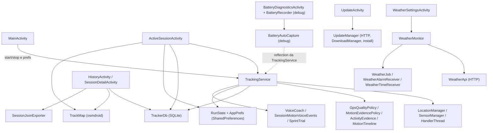

# Mappa delle dipendenze — baseline per ADR-002

**Stato:** inventario di progettazione, non una mappa statica esaustiva degli import.

**Baseline:** `main` @ `14effdeb6b8909a8e3110c3e432ee25e82d168a4` (2026-11-09). Nell'applicazione Java di produzione risultano 50 file `src/main`: 47 nel package legacy radice, 3 policy in `domain`. La source set `src/debug` ha `BatteryAutoCapture.java` e `BatteryDiagnosticsActivity.java` (il secondo contiene anche `BatteryRecorder`). Nel modulo singolo `app` vi sono test JVM in `tests/`, test Gradle `app/src/test/` e instrumentation in `app/src/androidTest/`.

## 1. Flussi osservati oggi



Le frecce sono **relazioni architetturali semplificate** ricavate dalla lettura dei file: non rappresentano ogni chiamata o import. In particolare l'arco di reflection reale è `TrackingService` che cerca il nome `BatteryAutoCapture` in `BuildConfig.DEBUG`; la freccia tratteggiata evidenzia la dipendenza, non il verso esatto della chiamata.

## 2. Responsabilità correnti → destinazione proposta

| Sottosistema / classi | Dipendenza problematica oggi | Confine/posizione desiderata | Trappole da controllare |
| --- | --- | --- | --- |
| `TrackingService` (~973 righe), `MainActivity` | Service combina lifecycle Android, state mutation, persistenza e segnali | `platform/service` + `application/tracking` + policy `domain` | `START_STICKY`, STOP prima di init, service destroy, callback Looper |
| `GpsQualityPolicy`, `MotionEvidencePolicy`, `MotionTimeline`, `MovementClassifier`, `DistanceAccumulator`, `RunMath` | Regole pure nel package legacy | `domain/tracking`, compat facade a breve termine | unità m/ms, stale/future/out-of-order, UNKNOWN, jitter |
| `InertialGaitDetector`, `StepCounterEvidence`, `ActivityEvidence`, `AdaptiveProfile` | Accoppiamento da callback e mutable state | dominio + adapter sensor; separare eventi, non inventare passi | sensor batching, freshness, detector assente |
| `SessionRecoveryPolicy`, `ForegroundStartPolicy`, `GpsFixPolicy` | Già pure in `domain` | mantenere, riesaminare collocazione durante riordino | formule e short-circuit invariati |
| `RunState`, `AppPrefs` | modello runtime e serializzazione SharedPreferences intrecciati | `domain/session` snapshot + `data/local` mapper/prefs adapter | chiavi `active_*`, bits double, `apply()`, restart |
| `TrackerDb` (~327 righe) | accesso SQLite diretto da service, storico, mappe | `data/local` implementa port di sessione e punti | DB v7, sprint, ID, transazioni, paginazione e delete |
| `ActiveSessionActivity` (~655), `MainActivity` (~273) | gestione UI e accesso a service/prefs/DB | `presentation/home` e `presentation/session` + use case | polling, stato di sessione, ripristino, permessi |
| `HistoryActivity`, `SessionDetailActivity`, `SessionJsonExporter` | SQLite e serializzazione coordinati vicino alla UI | `presentation/history`, `application/history`, `data/export` | SAF, export JSON compatibile, eliminazione sicura |
| `TrackMap`, `RouteSections`, `RouteSegmenter` | controller map UI legge punti da DB | domain route/policy; adapter mappa + reader port | ordine punti, segmenti sprint, buchi GPS, tile network |
| `SprintTrial`, voice plans, `VoiceCoach` | pianificazione pura e TTS intercalati nel service | domain sprint, application coordinamento, platform speech | countdown, priorità annunci, audio focus |
| `WeatherApi`, `WeatherMonitor`, `WeatherRules`, `WeatherSchedule`, `WeatherJob` e receiver | rete, preferenze, scheduling e regole mischiati | domain weather, application weather, data remote, platform scheduling | slot/fuso, BOOT_COMPLETED, rete assente, opt-in |
| `WeatherSettingsActivity` (~475) | UI legge/scrive prefs, coordina ricerche e rendering | presentation weather + use case e modelli view | cancellazioni/richieste tardive, località manuale, notifiche |
| `UpdateManager`, `UpdateActivity`, `UpdatePolicy`, `UpdateMetadataReader` | download/verifica/installazione in servizio statico e activity | domain update, application update, data remote, platform installer | certificato e SHA, `versionCode`, source URL, permessi install |
| `BatteryAutoCapture`, `BatteryDiagnosticsActivity`, `BatteryRecorder` | mutable static state, scheduling, recording, CSV nella source set debug | adapter/debug specifici; sessione di registrazione isolata | release senza debug, opt-in, CSV senza coordinate, stesso sampling |

## 3. Package e dipendenze desiderati

```text
presentation/*  ---> application/* ---> domain/*
data/*          ---> application/* ---> domain/*
platform/*      ---> application/* ---> domain/*
composition root (livello esterno) --> presentation, application, data, platform
```

- **Proibiti:** `domain`→Android/SQL/rete/UI; `application`→`data`/`platform`/UI; `presentation`→implementazioni `data`/`platform`.
- **Ammessi:** adapter concreti dipendono da port di `application`/`domain`; test possono dipendere da fake e adapter testabili.
- **Eccezione transitoria:** classi legacy in radice finché ciascun seam è migrato e testato. Ogni eccezione deve essere tracciata nell'issue corrispondente, con data e criterio di rimozione; non nascondere dipendenze con fully-qualified-name o reflection.
- **Proposta di composition root:** wiring all'esterno, ad esempio nell'`Application` Android mediante un contratto interno per fornire use case alla UI. Non vincolante finché una PR di wiring non lo dimostra con test.

## 4. Cross-cutting da non rompere

1. **Manifest e package classi:** `AndroidManifest.xml` riferisce Activity, Service e Receiver per nome. Uno spostamento richiede aggiornamento del manifest **nella stessa PR** e instrumentation API 30; preservare `applicationId`.
2. **Reflection debug:** `TrackingService` invoca dinamicamente `BatteryAutoCapture.onSessionStart/onSessionStop` sul package corrente. Rinominare/muovere la classe senza aggiornare il ponte può disabilitare silenziosamente la diagnostica. In release le classi debug non devono essere presenti.
3. **Visibilità Java:** alcune classi e helper sono package-private nel package radice; spostarle richiede valutare l'accesso senza esporre tutto come `public`.
4. **Persistenza locale:** `TrackerDb`, `RunState` e `AppPrefs` condividono formati non intercambiabili automaticamente. `RunState.save` usa `SharedPreferences.apply()`, dunque il refactor non deve supporre una transazione sincrona.
5. **Concorrenza:** `TrackingService` usa `HandlerThread`, callback su worker e scritture verso prefs/DB; `Activity` fa polling. Registrare ordine e ownership dei dati prima di introdurre use case.
6. **Updater e firma:** firma debug stabile, `versionCode`, certificato e file metadata sono parte di un contratto distribuito; separare adattatori senza cambiare protocollo o endpoint.
7. **Rete:** tracking core offline; meteo e updater hanno rete esplicita; osmdroid può richiedere tile di mappa. Non introdurre nuovi upload coordinate.
8. **Process death / battery:** test di schermo spento e ottimizzazioni OEM non possono essere conclusi dal solo emulatore; una baseline debug di consumo è solo comparativa.

## 5. Test e lacune da affrontare

| Esistente | Cosa protegge | Gap per il refactoring |
| --- | --- | --- |
| `tests/TrackingReplayTest.java`, `MotionRegressionTest.java`, `SessionRecoveryPolicyTest.java`, `ForegroundStartPolicyTest.java`, `GpsFixPolicyTest.java` | GNSS/step, tempi, permessi e gating equivalenti | aggiungere test sugli adapter che trasformano callback reali in input puri |
| `TrackingPersistenceInstrumentedTest` | snapshot, SQLite, v1→v7 su DB isolato | estendere test contratti dei nuovi repository e versioni storiche realmente supportate |
| `TrackingUiInstrumentedTest`, `Android11CompatibilityTest` | apertura schermate, ricreazione, manifest e API 30 | fake use case, navigazione, START/STOP foreground e permessi su device |
| `WeatherRulesTest`, `WeatherLocationsTest`, `WeatherScheduleTest` | parte della logica meteo pura | HTTP fake, scheduler/receiver, fuso orario, stato errore |
| `UpdatePolicyTest`, `UpdateMetadataReaderTest` | policy e parsing metadata | casi end-to-end hash/certificato, install permission e rollback |
| Diagnostica debug `BatteryRecorder` | acquisizione manuale disponibile | test del gate opt-in, timer e assenza diagnostica nella build release |

**Limite dell'attuale guardiano:** `tests/check-architecture.py` controlla gli import nei package layered ma esclude il legacy radice, e non vede reflection/nomi fully qualified. Estendere la copertura **incrementalmente** quando un'area migra; non attivare un gate impossibile per il legacy non ancora toccato.

## 6. Criteri della mappa

Questa pagina fotografa i confini visibili alla data della baseline, non promette che ogni riferimento dinamico sia stato ispezionato. Ogni issue operativa deve raccogliere un diagramma locale delle chiamate, indicare accessi diretti rilevati e aggiornare questa mappa prima di passare da facade a implementazione definitiva.

## 7. Seam P3a (issue #21): snapshot persistito di sessione

```text
TrackingService / Activity (legacy) -> RunState.read/save (facade mutabile)
                                   -> data/local/PreferencesSnapshotMapper -> SharedPreferences
                                   -> domain/session/RunSnapshot (valore puro)
AppPrefs.loadProfile/saveProfile (legacy) -> PreferencesSnapshotMapper
                                        -> domain/session/AdaptiveProfileSnapshot
```

L'adapter conosce solo `SharedPreferences` e snapshot di dominio; il Domain non importa classi Android, DB né package legacy. La facade `RunState` mantiene i suoi campi pubblici per non cambiare `TrackingService`, `TrackerDb` o la UI prima delle issue dedicate. La persistenza dei campi di runtime esclusi resta invariata: `lastTickElapsedMs` e `lastStepElapsedMs` non sono chiavi. Il marker `active` e il clock heartbeat appartengono all'adapter, non alla logica pura. Eccezione temporanea: i client legacy possono ancora importare `RunState` e `AppPrefs`; rimuovere solo quando i loro use case saranno migrati, con PR separata e equivalenza testata.


## 8. Seam P3b (issue #22): lettura storico/sprint/punti

```text
HistoryActivity / SessionDetailActivity / TrackMap (legacy)
    -> TrackerDb.{recent,session,pointsAfter,sprints,hasTaggedSprintPoints} (facade)
    -> application/history/SessionReadPort (DTO di sola lettura, Android-free)
       ^ 
       | implements
    data/local/SqliteSessionReadAdapter (SQLiteDatabase/Cursor)
```

`TrackerDb` possiede ancora helper/versione v7, scritture, delete e le API legacy; il reader prende un `SQLiteDatabase` già aperto senza chiuderlo e senza transazioni. I DTO nella port non dipendono dal legacy, Android o da `data`. Il ricalcolo di `averageKmh` per sprint vecchi resta nella facade per equivalenza e sarà riesaminato alla migrazione dei client. Eccezioni temporanee: UI e Service legacy continuano a usare `TrackerDb` direttamente fino alle issue #28–#30; `TrackerDb` delega al data adapter; scritture rimangono nel helper fino alla #23. Non cambiare schema, ordine, limiti o gestione dei `NULL`.


## 9. Primo seam P3c (issue #23): inserimento sessione

```text
TrackingService (legacy) -> TrackerDb.newSession(wall) (facade)
                            -> data/local/SqliteSessionCreationAdapter
                                  -> implements application/session/SessionCreationPort
                                  -> SQLiteOpenHelper.getWritableDatabase().insertOrThrow
```

`SessionCreationPort` è Java puro e non dipende da SQLite o Android; l'adapter `data/local` preserva la costruzione `ContentValues` prima dell'apertura del DB, la singola chiamata `insertOrThrow` e l'eventuale transazione del chiamante senza crearne una nuova. Il legacy `TrackerDb` continua a possedere schema v7, helper, reader ed altri writer. I successivi `snapshot`, `point` e `recordSprint` sono fuori scope fino a PR autonome nella #23. Nessun nuovo nodo di rete o permesso.


## 10. Secondo seam P3c (issue #23): inserimento punti GPS

```text
TrackingService (legacy) -> TrackerDb.point(id, ..., Kind/String) (facade)
    -> data/local/SqlitePointWriteAdapter
        -> implements application/session/PointWritePort (Android-free)
        -> SQLiteOpenHelper.getWritableDatabase().insertOrThrow("points")
```

L'overload enum resta nel legacy; `kind.name()` e le etichette `SPRINT:<id>` sono mantenute. Il nuovo adapter non aggiunge transazioni, controlli, clock, scritture o aperture persistenti. Il writer `newSession` del primo seam P3c resta invariato; `snapshot`, `recordSprint` e delete rimangono responsabilità di `TrackerDb` fino a PR dedicate. Nessun cambiamento dello schema v7 o dei client GPS.

