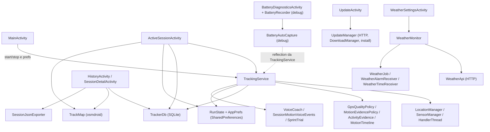

# Mappa delle dipendenze — baseline per ADR-002

**Stato:** inventario di progettazione, non una mappa statica esaustiva degli import.

**Baseline:** `main` @ `14effdeb6b8909a8e3110c3e432ee25e82d168a4` (2026-11-09). Nell'applicazione Java di produzione risultano 50 file `src/main`: 47 nel package legacy radice, 3 policy in `domain`. La source set `src/debug` ha `BatteryAutoCapture.java` e `BatteryDiagnosticsActivity.java` (il secondo contiene anche `BatteryRecorder`). Nel modulo singolo `app` vi sono test JVM in `tests/`, test Gradle `app/src/test/` e instrumentation in `app/src/androidTest/`.

## 1. Flussi osservati oggi



Le frecce sono **relazioni architetturali semplificate** ricavate dalla lettura dei file: non rappresentano ogni chiamata o import. In particolare l'arco di reflection reale è `TrackingService` che cerca il nome `BatteryAutoCapture` in `BuildConfig.DEBUG`; la freccia tratteggiata evidenzia la dipendenza, non il verso esatto della chiamata.

## 2. Responsabilità correnti → destinazione proposta

| Sottosistema / classi | Dipendenza problematica oggi | Confine/posizione desiderata | Trappole da controllare |
| --- | --- | --- | --- |
| `TrackingService` (~973 righe), `MainActivity` | Service combina lifecycle Android, state mutation, persistenza e segnali | `platform/service` + `application/tracking` + policy `domain` | `START_STICKY`, STOP prima di init, service destroy, callback Looper |
| `GpsQualityPolicy`, `MotionEvidencePolicy`, `MotionTimeline`, `MovementClassifier`, `DistanceAccumulator`, `RunMath` | Regole pure nel package legacy | `domain/tracking`, compat facade a breve termine | unità m/ms, stale/future/out-of-order, UNKNOWN, jitter |
| `InertialGaitDetector`, `StepCounterEvidence`, `ActivityEvidence`, `AdaptiveProfile` | Accoppiamento da callback e mutable state | dominio + adapter sensor; separare eventi, non inventare passi | sensor batching, freshness, detector assente |
| `SessionRecoveryPolicy`, `ForegroundStartPolicy`, `GpsFixPolicy` | Già pure in `domain` | mantenere, riesaminare collocazione durante riordino | formule e short-circuit invariati |
| `RunState`, `AppPrefs` | modello runtime e serializzazione SharedPreferences intrecciati | `domain/session` snapshot + `data/local` mapper/prefs adapter | chiavi `active_*`, bits double, `apply()`, restart |
| `TrackerDb` (~327 righe) | accesso SQLite diretto da service, storico, mappe | `data/local` implementa port di sessione e punti | DB v7, sprint, ID, transazioni, paginazione e delete |
| `ActiveSessionActivity` (~655), `MainActivity` (~273) | gestione UI e accesso a service/prefs/DB | `presentation/home` e `presentation/session` + use case | polling, stato di sessione, ripristino, permessi |
| `HistoryActivity`, `SessionDetailActivity`, `SessionJsonExporter` | SQLite e serializzazione coordinati vicino alla UI | `presentation/history`, `application/history`, `data/export` | SAF, export JSON compatibile, eliminazione sicura |
| `TrackMap`, `RouteSections`, `RouteSegmenter` | controller map UI legge punti da DB | domain route/policy; adapter mappa + reader port | ordine punti, segmenti sprint, buchi GPS, tile network |
| `SprintTrial`, voice plans, `VoiceCoach` | pianificazione pura e TTS intercalati nel service | domain sprint, application coordinamento, platform speech | countdown, priorità annunci, audio focus |
| `WeatherApi`, `WeatherMonitor`, `WeatherRules`, `WeatherSchedule`, `WeatherJob` e receiver | rete, preferenze, scheduling e regole mischiati | domain weather, application weather, data remote, platform scheduling | slot/fuso, BOOT_COMPLETED, rete assente, opt-in |
| `WeatherSettingsActivity` (~475) | UI legge/scrive prefs, coordina ricerche e rendering | presentation weather + use case e modelli view | cancellazioni/richieste tardive, località manuale, notifiche |
| `UpdateManager`, `UpdateActivity`, `UpdatePolicy`, `UpdateMetadataReader` | download/verifica/installazione in servizio statico e activity | domain update, application update, data remote, platform installer | certificato e SHA, `versionCode`, source URL, permessi install |
| `BatteryAutoCapture`, `BatteryDiagnosticsActivity`, `BatteryRecorder` | mutable static state, scheduling, recording, CSV nella source set debug | adapter/debug specifici; sessione di registrazione isolata | release senza debug, opt-in, CSV senza coordinate, stesso sampling |

## 3. Package e dipendenze desiderati

```text
presentation/*  ---> application/* ---> domain/*
data/*          ---> application/* ---> domain/*
platform/*      ---> application/* ---> domain/*
composition root (livello esterno) --> presentation, application, data, platform
```

- **Proibiti:** `domain`→Android/SQL/rete/UI; `application`→`data`/`platform`/UI; `presentation`→implementazioni `data`/`platform`.
- **Ammessi:** adapter concreti dipendono da port di `application`/`domain`; test possono dipendere da fake e adapter testabili.
- **Eccezione transitoria:** classi legacy in radice finché ciascun seam è migrato e testato. Ogni eccezione deve essere tracciata nell'issue corrispondente, con data e criterio di rimozione; non nascondere dipendenze con fully-qualified-name o reflection.
- **Proposta di composition root:** wiring all'esterno, ad esempio nell'`Application` Android mediante un contratto interno per fornire use case alla UI. Non vincolante finché una PR di wiring non lo dimostra con test.

## 4. Cross-cutting da non rompere

1. **Manifest e package classi:** `AndroidManifest.xml` riferisce Activity, Service e Receiver per nome. Uno spostamento richiede aggiornamento del manifest **nella stessa PR** e instrumentation API 30; preservare `applicationId`.
2. **Reflection debug:** `TrackingService` invoca dinamicamente `BatteryAutoCapture.onSessionStart/onSessionStop` sul package corrente. Rinominare/muovere la classe senza aggiornare il ponte può disabilitare silenziosamente la diagnostica. In release le classi debug non devono essere presenti.
3. **Visibilità Java:** alcune classi e helper sono package-private nel package radice; spostarle richiede valutare l'accesso senza esporre tutto come `public`.
4. **Persistenza locale:** `TrackerDb`, `RunState` e `AppPrefs` condividono formati non intercambiabili automaticamente. `RunState.save` usa `SharedPreferences.apply()`, dunque il refactor non deve supporre una transazione sincrona.
5. **Concorrenza:** `TrackingService` usa `HandlerThread`, callback su worker e scritture verso prefs/DB; `Activity` fa polling. Registrare ordine e ownership dei dati prima di introdurre use case.
6. **Updater e firma:** firma debug stabile, `versionCode`, certificato e file metadata sono parte di un contratto distribuito; separare adattatori senza cambiare protocollo o endpoint.
7. **Rete:** tracking core offline; meteo e updater hanno rete esplicita; osmdroid può richiedere tile di mappa. Non introdurre nuovi upload coordinate.
8. **Process death / battery:** test di schermo spento e ottimizzazioni OEM non possono essere conclusi dal solo emulatore; una baseline debug di consumo è solo comparativa.

## 5. Test e lacune da affrontare

| Esistente | Cosa protegge | Gap per il refactoring |
| --- | --- | --- |
| `tests/TrackingReplayTest.java`, `MotionRegressionTest.java`, `SessionRecoveryPolicyTest.java`, `ForegroundStartPolicyTest.java`, `GpsFixPolicyTest.java` | GNSS/step, tempi, permessi e gating equivalenti | aggiungere test sugli adapter che trasformano callback reali in input puri |
| `TrackingPersistenceInstrumentedTest` | snapshot, SQLite, v1→v7 su DB isolato | estendere test contratti dei nuovi repository e versioni storiche realmente supportate |
| `TrackingUiInstrumentedTest`, `Android11CompatibilityTest` | apertura schermate, ricreazione, manifest e API 30 | fake use case, navigazione, START/STOP foreground e permessi su device |
| `WeatherRulesTest`, `WeatherLocationsTest`, `WeatherScheduleTest` | parte della logica meteo pura | HTTP fake, scheduler/receiver, fuso orario, stato errore |
| `UpdatePolicyTest`, `UpdateMetadataReaderTest` | policy e parsing metadata | casi end-to-end hash/certificato, install permission e rollback |
| Diagnostica debug `BatteryRecorder` | acquisizione manuale disponibile | test del gate opt-in, timer e assenza diagnostica nella build release |

**Limite dell'attuale guardiano:** `tests/check-architecture.py` controlla gli import nei package layered ma esclude il legacy radice, e non vede reflection/nomi fully qualified. Estendere la copertura **incrementalmente** quando un'area migra; non attivare un gate impossibile per il legacy non ancora toccato.

## 6. Criteri della mappa

Questa pagina fotografa i confini visibili alla data della baseline, non promette che ogni riferimento dinamico sia stato ispezionato. Ogni issue operativa deve raccogliere un diagramma locale delle chiamate, indicare accessi diretti rilevati e aggiornare questa mappa prima di passare da facade a implementazione definitiva.

## 7. Seam P3a (issue #21): snapshot persistito di sessione

```text
TrackingService / Activity (legacy) -> RunState.read/save (facade mutabile)
                                   -> data/local/PreferencesSnapshotMapper -> SharedPreferences
                                   -> domain/session/RunSnapshot (valore puro)
AppPrefs.loadProfile/saveProfile (legacy) -> PreferencesSnapshotMapper
                                        -> domain/session/AdaptiveProfileSnapshot
```

L'adapter conosce solo `SharedPreferences` e snapshot di dominio; il Domain non importa classi Android, DB né package legacy. La facade `RunState` mantiene i suoi campi pubblici per non cambiare `TrackingService`, `TrackerDb` o la UI prima delle issue dedicate. La persistenza dei campi di runtime esclusi resta invariata: `lastTickElapsedMs` e `lastStepElapsedMs` non sono chiavi. Il marker `active` e il clock heartbeat appartengono all'adapter, non alla logica pura. Eccezione temporanea: i client legacy possono ancora importare `RunState` e `AppPrefs`; rimuovere solo quando i loro use case saranno migrati, con PR separata e equivalenza testata.


## 8. Seam P3b (issue #22): lettura storico/sprint/punti

```text
HistoryActivity / SessionDetailActivity / TrackMap (legacy)
    -> TrackerDb.{recent,session,pointsAfter,sprints,hasTaggedSprintPoints} (facade)
    -> application/history/SessionReadPort (DTO di sola lettura, Android-free)
       ^ 
       | implements
    data/local/SqliteSessionReadAdapter (SQLiteDatabase/Cursor)
```

`TrackerDb` possiede ancora helper/versione v7, scritture, delete e le API legacy; il reader prende un `SQLiteDatabase` già aperto senza chiuderlo e senza transazioni. I DTO nella port non dipendono dal legacy, Android o da `data`. Il ricalcolo di `averageKmh` per sprint vecchi resta nella facade per equivalenza e sarà riesaminato alla migrazione dei client. Eccezioni temporanee: UI e Service legacy continuano a usare `TrackerDb` direttamente fino alle issue #28–#30; `TrackerDb` delega al data adapter; scritture rimangono nel helper fino alla #23. Non cambiare schema, ordine, limiti o gestione dei `NULL`.


## 9. Primo seam P3c (issue #23): inserimento sessione

```text
TrackingService (legacy) -> TrackerDb.newSession(wall) (facade)
                            -> data/local/SqliteSessionCreationAdapter
                                  -> implements application/session/SessionCreationPort
                                  -> SQLiteOpenHelper.getWritableDatabase().insertOrThrow
```

`SessionCreationPort` è Java puro e non dipende da SQLite o Android; l'adapter `data/local` preserva la costruzione `ContentValues` prima dell'apertura del DB, la singola chiamata `insertOrThrow` e l'eventuale transazione del chiamante senza crearne una nuova. Il legacy `TrackerDb` continua a possedere schema v7, helper, reader ed altri writer. I successivi `snapshot`, `point` e `recordSprint` sono fuori scope fino a PR autonome nella #23. Nessun nuovo nodo di rete o permesso.


## 10. Secondo seam P3c (issue #23): inserimento punti GPS

```text
TrackingService (legacy) -> TrackerDb.point(id, ..., Kind/String) (facade)
    -> data/local/SqlitePointWriteAdapter
        -> implements application/session/PointWritePort (Android-free)
        -> SQLiteOpenHelper.getWritableDatabase().insertOrThrow("points")
```

L'overload enum resta nel legacy; `kind.name()` e le etichette `SPRINT:<id>` sono mantenute. Il nuovo adapter non aggiunge transazioni, controlli, clock, scritture o aperture persistenti. Il writer `newSession` del primo seam P3c resta invariato; `snapshot`, `recordSprint` e delete rimangono responsabilità di `TrackerDb` fino a PR dedicate. Nessun cambiamento dello schema v7 o dei client GPS.


## 11. Terzo seam P3c (issue #23): snapshot sessione SQLite

```text
TrackingService (legacy) -> TrackerDb.snapshot(RunState, elapsedMs, finished)
    -> application/session/SessionSnapshotWritePort.Values (Android-free)
    -> data/local/SqliteSessionSnapshotAdapter
        -> SQLiteOpenHelper.getWritableDatabase().update("sessions", ..., "id=?")
```

Il mapper nella facade copia solo i campi persistiti in un valore immutabile per il port. La conversione `NULL`, il wall clock alla chiusura e la singola `update` restano proprietà dell'adapter. Il layer application non importa Android/legacy, mentre `TrackerDb` è ancora la facade temporanea. Il numero e il timing dei trigger degli snapshot non cambiano. La scrittura sprint `recordSprint` rimane nel legacy fino a una PR indipendente, con propri test prima dell'estrazione.


## 12. Quarto seam P3c (issue #23): writer sprint SQLite

```text
TrackingService (legacy) -> TrackerDb.recordSprint(sessionId, SprintTrial, monotonicMs)
    -> SessionSprintWritePort.Values (application/session, Android-free)
    -> data/local/SqliteSprintWriteAdapter
        -> SQLiteOpenHelper.getWritableDatabase().insertOrThrow("sprints")
```

La facade conserva la verifica delle fasi FINISHED/CANCELLED e le chiamate al `SprintTrial`; il wall clock viene acquisito prima dei dati sprint. La conversione dei valori medi/peak in `NULL` e gli 11 campi di `ContentValues` risiedono nell'adapter. Nessun nuovo thread, transazione, cambiamento del DB o chiamante. I seam P3c `newSession`, `point`, `snapshot` sono rimasti invariati. La cancellazione in `TrackerDb.deleteSession` resta legacy e sarà trattata nel lotto UI/history pertinente, non nel writer sprint.


## 13. Primo seam P4a (issue #24): ingresso START/ripristino e STOP anticipato

```text
Android Intent / FGS -> TrackingService (legacy; worker, sensors, prefs and SQLite)
                           -> application/tracking/SessionEntryCoordinator
                                 (BooleanSupplier active, LongSupplier activeId)
                           -> legacy RunState / TrackerDb (solo dopo la decisione)
```

Il coordinator possiede soltanto il predicato `active && active_id>0` per scegliere ripristino/nuova sessione e la lettura di `active` per STOP-before-init. Le lambda preservano la valutazione pigra delle preferenze e propagano le eccezioni tipizzate preesistenti. `TrackingService` mantiene l'ordine `startForeground` prima di `initializeTracking`, la creazione e il salvataggio dei dati sul worker, e `stopSelf` su STOP inattivo. Non sono spostati il ripristino dei clock, il teardown, FGS, GPS, TTS, notifiche o i checkpoint. L'estrazione futura richiede fake di orchestrazione/side effect, instrumentation e prove fisiche, senza anticipare il successivo lotto #25.


## 14. Secondo seam P4a (issue #24): dispatch azioni Android

```text
Intent(action) -> TrackingService.onStartCommand (legacy)
                    -> application/tracking/TrackingCommandClassifier.classify
                    -> branch legacy STOP / label / sprint / foreground START
                    -> handler / sensors / preferences / SQLite (invariati)
```

`TrackingCommandClassifier` dipende solo da `String` e Java; non importa `Intent`, `Service`, `TrackingService` né platform. Il Service conserva firme, token e return code, la lettura degli extra sprint soltanto nel branch pertinente, il controllo GPS/permessi e l'ordine `startForeground` → enqueue `initializeTracking`. FGS, worker, recovery e STOP non sono stati spostati né testati end-to-end in questo seam.

## 15. Primo seam P4b (issue #25): invalidazione dell'evidenza di andatura

```text
TrackingService.advanceTimeline (legacy, worker Android)
    -> MotionTimeline.advance(...) / visible() (ledger legacy invariato)
    -> application/tracking/TrackingGaitTransition.shouldInvalidateGait(
           previous.name(), current.name()) (decisione pura)
    -> [se true] ActivityEvidence.onMotionState(current) (effetto legacy)
    -> applyTimeline() / SessionMotionVoiceEvents.observe(...) (ordine invariato)
```

Il primo seam P4b sposta **soltanto** il predicato «stato visibile cambiato verso
`STILL` oppure `UNKNOWN`» in `application/tracking`. Il contratto di ingresso
è costituito dai nomi stabili dell'enum `MovementClassifier.Kind`; la conversione
`name()` avviene nel Service legacy, senza dipendenza `application` → package legacy.
L'application restituisce una decisione booleana senza side effect e il Service
mantiene il reset di `ActivityEvidence` **dopo** l'avanzamento del ledger e **prima**
della proiezione in `RunState` e degli annunci vocali.

Baseline G1: la PR #91 caratterizza WALK/STOP, UNKNOWN, callback fuori ordine e gap
worker. La PR di questo seam aggiunge la parità esaustiva della decisione per
tutte le coppie di `Kind` esistenti. Nessun cambio di soglie, intervalli, GPS,
step, snapshot, Preferences, SQLite, START/STOP, foreground o voce. Il Service
e `MotionTimeline` rimangono legacy; la migrazione di altre transizioni richiede
PR separate. I test JVM non sostituiscono il collaudo hardware G3 differito di
#24 né la review e i check `verify`/`android11`.

## 16. Secondo seam P4b (issue #25): decisione sul gap di callback non osservato

```text
TrackingService.advanceTimeline / callback worker (legacy, invariati)
    -> MotionTimeline.advance(nowMs, evidence, activity) (legacy)
        -> calcola dt dopo il controllo monotono (invariato)
        -> domain/tracking/UnobservedIntervalPolicy.isUnobservedGap(dt)
            [true solo per dt > 5_000 ms]
        -> [true] finish(), accredito dt in UNKNOWN, reset visibile
            e ritorno anticipato (restano nel ledger legacy)
        -> [false] normali transizioni e contabilizzazione (invariati)
```

Il seam estrae **soltanto** la decisione booleana `dt > UNKNOWN_GRACE_MS`.
La soglia costante di **5.000 ms**, precedentemente privata in `MotionTimeline`,
è ora condivisa tramite `UnobservedIntervalPolicy.UNKNOWN_GRACE_MS`: anche la
comparazione già esistente `nowMs - uncertainSince < UNKNOWN_GRACE_MS` mantiene
gli stessi operandi, l'ordine e la stessa soglia. Rimangono invariati i controlli
per callback fuori ordine, il calcolo di `dt`, la risoluzione dei periodi
`pending` in `finish()`, gli accrediti `UNKNOWN`, lo stato `committed`/
`displayed`, il reset dei contatori temporali e l'ordine degli effetti.

**G1 preesistente:** PR #93 integrata con test di caratterizzazione dei limiti
5.000/5.001 ms, callback duplicate/stale, STOP non confermato e conservazione del
ledger. La nuova suite JVM confronta l'esatta decisione con il confronto legacy,
anche per zero, negativo ed estremi del tipo `long`.

**Valutazione deroga #24:** questa estrazione non altera materialmente
START/STOP, inizializzazione, resume/process death, frequenza GPS, servizio
foreground, persistenza SQLite/Preferences o side effect: la decisione riceve
esattamente il `dt` calcolato dal ledger e restituisce lo stesso booleano.
Non sono aggiunti call site né viene modificato il recupero di sessione.
I rari casi G3 fisici differiti di #24 restano **non verificati** e necessari
per il gate finale #38; CI emulata non li sostituisce. In caso di regressione
su recovery, dati, GPS/FGS o tempi UNKNOWN: stop del lotto P4b e analisi in #24.
Rollback: revert della singola PR senza migrazioni.

## 17. Terzo seam P4b (issue #25): scadenza dell'incertezza continua

```text
TrackingService.advanceTimeline() (legacy, invariato)
    -> MotionTimeline.advance(nowMs, evidence, activity) (legacy)
        -> ramo MOVING / STILL (ordine invariato)
        -> ramo UNCERTAIN con uncertainSince inizializzato come prima
           -> domain/tracking/UncertaintyGracePolicy.shouldKeepPending(
                  nowMs - uncertainSince)
              [true solo se durata < 5_000 ms]
           -> [true] accumulo unresolvedMs += dt (legacy)
           -> [false] unknownMs += unresolvedMs + dt;
              committed/displayed = UNKNOWN (legacy)
```

La PR estrae **soltanto** il predicato `nowMs - uncertainSince <
UnobservedIntervalPolicy.UNKNOWN_GRACE_MS` in una decisione pura del Domain.
La nuova `UncertaintyGracePolicy` usa la **stessa costante di 5.000 ms**
già condivisa con `UnobservedIntervalPolicy`, senza crearne una seconda.
La differenza è funzionale: l'estrazione precedente #94 gestiva il **gap
tra due callback** (`dt > 5.000`), mentre questo seam gestisce la **durata
cumulativa di evidenza UNCERTAIN** (`durata < 5.000`).

Il ledger legacy conserva l'ordine dei rami `MOVING`, `STILL`, `UNCERTAIN`,
l'inizializzazione di `uncertainSince`, il calcolo degli operandi, la
contabilità `UNKNOWN` e `unresolved`, il reset di `committed` e
`displayed`, `finish()`, `restore()` e le API pubbliche. Nessun
cambiamento del `TrackingService` né nuovi side effect.

**G1 caratterizzato prima della produzione:** PR #95 integrata con quattro
test di confine 4.999/5.000 ms, recupero MOVING, incertezza iniziale e STOP
non confermato, oltre ai test #91/#93 preesistenti. La PR di estrazione
aggiunge un test del predicato ai confini, per numeri negativi e per gli
estremi `long`; `tests/run-core-tests.sh` include la nuova classe Java
nella lista esplicita di compilazione del runner.

**Valutazione della deroga #24:** il cambiamento è unicamente una decisione
senza stato con identici input e output, non altera materialmente START/STOP,
process death, ripristino, foreground, GPS/step, SQLite, Preferences,
snapshot, thread, voice, UI o la loro sequenza. I test G3 fisici differiti
della #24 rimangono **NON PASS**; il gate finale è #38. Qualsiasi regressione
su recupero, doppie sessioni, tempi UNKNOWN, dati, GPS o FGS ferma il lotto
P4b e richiede nuova valutazione in #24. Rollback: revert isolato della PR,
senza migrazioni dati.

## 18. Quarto seam P4b (issue #25): conferma dell'inizio movimento

```text
TrackingService.advanceTimeline() (legacy, invariato)
    -> MotionTimeline.advance(nowMs, evidence, activity) (legacy)
       -> timestamp/callback monotoni e filtro del worker gap (invariati)
       -> ramo MOVING, dopo la gestione di uncertainty/stop (invariata)
          -> if (!isMoving(committed)) (legacy)
             -> movingSince = nowMs - dt, se non ancora inizializzato
             -> unresolvedMs += dt
             -> domain/tracking/MovementStartConfirmationPolicy.isConfirmed(
                    nowMs - movingSince)
                [true se durata >= 2_000 ms]
             -> [true] attribuzione del gait e credito dei pending nel ledger
                (legacy, ordine e contatori invariati)
```

La PR sposta **soltanto** la decisione booleana `nowMs - movingSince >=
START_CONFIRM_MS` nel Domain puro, con `START_CONFIRM_MS = 2_000L`
definito in `MovementStartConfirmationPolicy`. Nessun input viene ricalcolato:
la sottrazione resta nel ledger, dopo l'inizializzazione del timestamp di
inizio e l'accredito del `dt` pendente. Il Domain non importa classi legacy,
Android, application o platform.

Il ledger conserva i rami di evidenza, i return, l'ordine dei callback,
`movingSince` e `unresolvedMs`, la scelta di `RUN`/`WALK`/
`MOVING_UNKNOWN` al momento della conferma, lo stato `committed`/
`displayed` e tutti i side effect. Nessuna modifica a `TrackingService`,
`RunState`, `TrackerDb`, GPS, step, voce o lifecycle.

**Baseline G1:** PR #97, mergiata prima dell'estrazione, con soglia di
1.999/2.000 ms, gait al momento della conferma, stop della sessione prima
di confermare, interruzione UNCERTAIN e ripartenza da STILL; ogni test
verifica la conservazione temporale. Questa PR aggiunge test unitari di
parità per i confini e gli estremi di tipo `long` e include la classe
nel `javac` portabile in `tests/run-core-tests.sh`.

**Deroga #24 / G3:** nessuna modifica materiale a START/STOP, FGS,
process death, recovery, sensori, persist SQLite/Preferences o ordine
degli effetti. Restano **non superate** le prove fisiche Android 11
differite nella #24, richieste per il gate finale #38. Una regressione
su UNKNOWN, recovery, duplicazione sessioni, GPS/FGS o dati storici ferma
P4b e richiede rivalutazione della #24. Rollback: revert della singola
PR, senza migrazione dati.

## 19. Quinto seam P4b (issue #25): decisione di conferma della sosta

```text
TrackingService.advanceTimeline() (legacy, invariato)
  -> MotionTimeline.advance(nowMs, evidence, activity, minimumStopMs)
     -> filtro timestamp e gap non osservato (invariati)
     -> ramo STILL_STRONG / STILL_MODERATE (legacy)
        -> gestione STILL già confermato (legacy)
        -> stopSince inizializzato, stopPendingMs += dt (legacy)
        -> required = evidenza corrente ? 4_000 ms : 8_000 ms (legacy)
        -> required = Math.max(required, minimumStopMs) (legacy)
        -> domain/tracking/StopConfirmationPolicy.isConfirmed(
               nowMs - stopSince, required)
           [true solo se elapsedStillEvidenceMs >= requiredStopMs]
        -> [true] committed/displayed = STILL; stillMs += stopPendingMs;
           unknownMs += unresolvedMs; reset pending (legacy)
```

Il seam sposta **soltanto** il confronto booleano `nowMs - stopSince >=
required` in una policy pura di dominio. La sottrazione `nowMs - stopSince`
resta nel ledger, così come le soglie originali `STRONG_STOP_MS = 4_000`
e `MODERATE_STOP_MS = 8_000`, la selezione sulla **evidenza corrente** e
l'override `Math.max(required, minimumStopMs)` per la latenza dei report
cumulativi del contapassi (tipicamente `StepCounterEvidence.STOP_CONFIRM_MS
= 12_000`). Non cambia alcuna condizione di conferma, neppure al bordo.

Il domain non conosce `MotionEvidencePolicy`, `MotionTimeline`, i sensori,
Android, application né classi legacy. `TrackingService`, l'ordine dei
callback e dei side effect, l'attribuzione dei microstop, il trattamento dei
report di passi ritardati, `unknownMs`, `stillMs`, `runMs`, `finish()`
e `restore()` restano invariati.

**G1 prima del cambio:** PR #99, test di caratterizzazione STOP forte a
3.999/4.000 ms, moderato a 7.999/8.000 ms, budget di ritardo a 12.000 ms,
alternanza forza evidenza, microstop, report step sovrapposti, gap worker,
conservazione del ledger. La PR presente aggiunge test unitari sulla parità
del predicato ai confini e per estremi `long`; il runner JVM portabile
include esplicitamente il file nel comando `javac`.

**Valutazione deroga #24/G3:** seam deterministico senza modifica materiale
a GPS, sensori, FGS, START/STOP, process death, recovery, SQLite,
SharedPreferences, snapshot o UI. Le prove fisiche differite dalla #24
restano **NON PASS** e devono essere riesaminate nel gate finale #38;
l'emulatore API30 non le sostituisce. Se compaiono regressioni su dati,
sessioni duplicate, UNKNOWN, recovery o GPS/FGS, fermare P4b e rivalutare
la #24. Rollback: revert isolato della PR senza migrazioni.

## 20. Sesto seam P4b (issue #25): revoca dello STOP pendente da step tardivo

```text
TrackingService callback step/contatore (legacy, invariato)
  -> MotionTimeline.observeDelayedStep(stepMs) (legacy)
     -> domain/tracking/PendingStopRevocationPolicy.shouldRevoke(
            stopSince, stepMs)
        [true solo se stopSince >= 0 && stepMs >= stopSince]
     -> [true] unknownMs += stopPendingMs;
        stopPendingMs = 0; stopSince = -1 (ledger legacy)
```

Il seam estrae **soltanto** il predicato booleano `stopSince >= 0 &&
stepMs >= stopSince` in `domain/tracking/PendingStopRevocationPolicy`,
senza calcolare nuove durate, introdurre clock o cambiare l'ordine delle
condizioni. I timestamp sono passati identici; il sentinel `stopSince = -1`
continua a rappresentare l'assenza di un pending-stop. Uno step esattamente
all'istante iniziale della sosta pendente revoca, uno precedente no.

`MotionTimeline` mantiene l'intera mutazione di `unknownMs`,
`stopPendingMs` e `stopSince`, senza variazioni a `finish()`,
`restore()`, `advance()` o al ledger conservativo. La policy è Java
puro, non importa classi legacy, Android, application o platform. Restano
immutati il filtro dei report del contapassi, il worker, la latenza di
delivery, GPS e ogni altro callback del Service.

**G1 precedente:** PR #101 integrata prima del cambio, con sei test
deterministici per confini step/stop, duplicati, secondo pending, stop
confermato, blackout worker, report cumulativi e UNCERTAIN. La nuova PR
aggiunge un test di equivalenza della condizione per coppie di `long`
ai confini, inclusi valori negativi ed estremi, e include la nuova
classe in `tests/run-core-tests.sh` per il `javac` portabile.

**Deroga #24 / G3:** la singola sostituzione del predicato non modifica
materialmente START/STOP, process death, restore, GPS/step sampling,
servizio foreground, SQLite/Preferences o i side effect. Le prove G3
fisiche rare differite della #24 restano **NON PASS** e dovranno essere
verificate al gate #38; i test su emulatore Android 11 non le
sostituiscono. Regressione su UNKNOWN, storico, recovery, duplicazione
sessioni o GPS/FGS implica stop a P4b e rivalutazione della #24.
Rollback: revert della singola PR senza migrazione dati.

## 21. Settimo seam P4b (issue #25): affidabilità della categoria gait

```text
TrackingService.advanceTimeline() (legacy, invariato)
  -> MotionTimeline.advance(nowMs, MOVING, activity) (legacy)
     -> se !isMoving(committed): conferma movimento (predicato P4b già isolato)
        -> domain/tracking/ReliableGaitPolicy.hasKnownGait(activity name)
           [true solo per RUN o WALK]
        -> [true] committed = activity; [false] MOVING_UNKNOWN (legacy)
        -> displayed = committed, credit(committed, unresolvedMs) (legacy)
     -> altrimenti: MOVING già confermato, credit(committed, unresolvedMs)
        -> domain/tracking/ReliableGaitPolicy.hasKnownGait(activity name)
           [true solo per RUN o WALK]
        -> [true] committed/displayed = activity
           [false] committed/displayed = MOVING_UNKNOWN (legacy)
        -> credit(committed, dt) (legacy)
```

Il seam estrae una **sola decisione riutilizzata in due call site**:
`activity == RUN || activity == WALK` diventa
`ReliableGaitPolicy.hasKnownGait(activityName)`. Il boundary legacy
traduce il valore dell'enum con `activity.name()`; un input
`activity == null` viene passato come `null`, mantenendo lo stesso
fallback `MOVING_UNKNOWN` del confronto precedente, senza eccezioni
nuove. La policy pura non conosce `MovementClassifier`, Android,
application, platform o altri componenti legacy.

Il ledger conserva i rami `MOVING` pendente/confermato, la conferma
temporale, il riaccredito dei periodi `UNCERTAIN` al movimento
precedente, lo stato `committed/displayed`, tutti i contatori e
l'ordine dei `credit`. `isMoving(committed)`, che comprende anche
`MOVING_UNKNOWN`, resta volutamente **distinto** dal riconoscimento
di una categoria gait affidabile; nessuna modifica a STOP, gap worker,
restore, Service o persistenza.

**G1 precedente:** PR #103 integrata su `main` prima del cambio, con
sei test di transizione `RUN/WALK/MOVING_UNKNOWN`, fallback, ripresa
da UNCERTAIN/STOP, callback stale e gap worker, con ledger conservativo.
Nuova verifica diretta: equivalenza del predicato per i cinque stati
di `MovementClassifier.Kind`, `null` e stringhe non riconosciute.
Il runner JVM portabile include esplicitamente la nuova classe nel
comando `javac`.

**Deroga #24/G3:** la modifica è una comparazione pura equivalente,
non altera materialmente START/STOP, process death, FGS, GPS/step,
recovery, SQLite/Preferences, UI o sequenze di effetti. I G3 fisici
differiti in #24 restano **NON PASS**, da riesaminare a #38; l'emulatore
Android 11 non li sostituisce. In caso di regressione su UNKNOWN,
contabilità, dati, recovery, sessioni duplicate o GPS/FGS, sospendere
P4b e rivalutare #24. Rollback: revert della sola PR senza migrazioni.

## 22. Ottavo seam P4b (issue #25): riconoscimento del movimento già confermato

```text
TrackingService.advanceTimeline() (legacy, invariato)
  -> MotionTimeline.advance(nowMs, MOVING, activity) (legacy)
     -> se uncertainSince >= 0 (legacy):
        -> domain/tracking/ConfirmedMotionPolicy.isMoving(committed name)
           [true: RUN / WALK / MOVING_UNKNOWN]
        -> [true] credit(committed, unresolvedMs)
           [false] unknownMs += unresolvedMs (ledger legacy)
     -> dopo il reset di stopSince e relative attribuzioni (legacy):
        -> domain/tracking/ConfirmedMotionPolicy.isMoving(committed name)
           [false] avvia la conferma MOVING da 2.000 ms (ledger legacy)
           [true] prosegue il MOVING già confermato (ledger legacy)
```

L'estrazione riguarda **una sola classificazione di stato**, riutilizzata in
due punti: il predicato privato legacy `isMoving(committed)` equivale a
`committed == RUN || committed == WALK || committed == MOVING_UNKNOWN`.
Il nuovo `ConfirmedMotionPolicy.isMoving(String)` confronta i medesimi
nomi dell'enum; il boundary legacy passa `committed.name()` oppure
`null` senza introdurre nuove eccezioni. Il predicato precedente è
rimosso, senza spostare gli effetti del chiamante. `ReliableGaitPolicy`
(§21) continua a significare **solo RUN/WALK affidabili** e NON deve
essere usata per determinare se un MOVING_UNKNOWN è già confermato.

Il ledger conserva i test `uncertainSince` e `stopSince`, il
`MovementStartConfirmationPolicy` dei 2 secondi, tutte le assegnazioni
a `committed/displayed`, i `credit` e `unknownMs`, i tempi
pendenti, la gestione delle evidenze STILL e dei gap, `finish()`,
`restore()` e l'ordine dei callback. Nessuna nuova dipendenza dal
Domain verso classi legacy, Android o application; nessuna modifica
a `TrackingService` o a persistenza.

**G1 prima del codice produttivo:** i sei test di transizione gait di
PR #103 erano già integrati, con CI post-merge `verify`/
`android11` verdi; sul branch presente sono stati aggiunti prima
della modifica tre test di caratterizzazione su MOVING_UNKNOWN dopo
UNCERTAIN, ripartenza da STILL e gap worker prima di applicare il
cambio di produzione. Un test diretto confronta tutte le cinque
varianti `MovementClassifier.Kind` con il predicato originale e
verifica `null`/valori non riconosciuti; il runner portabile compila
la nuova policy nell'elenco esplicito `javac`.

**Rischio/G3 #24:** singola classificazione pura senza modificare
materialmente START/STOP, FGS, GPS, recovery, process death,
SQLite/Preferences, snapshot, UI, sensori, endpoint o permessi. Le
prove fisiche G3 rare rinviate dalla #24 restano **NON PASS** e
richiedono valutazione finale al gate #38. Se compaiono regressioni
su UNKNOWN, contabilità, dati, recovery, sessioni duplicate, GPS/FGS
sospendere P4b e riesaminare #24. Rollback: revert isolato della PR,
nessuna migrazione dati.

## 23. Nono seam P4b (issue #25): scelta della soglia STOP effettiva

```text
TrackingService.advanceTimeline() (legacy, invariato)
  -> MotionTimeline.advance(nowMs, evidence, activity, minimumStopMs) (legacy)
     -> ramo STILL_STRONG / STILL_MODERATE, con stato pending (legacy)
        -> stopSince e stopPendingMs (ledger legacy, invariati)
        -> domain/tracking/EffectiveStopThresholdPolicy.requiredStopMs(
               evidence.name(), minimumStopMs)
           [STILL_STRONG: max(4_000, minimumStopMs);
            ogni altra evidenza: max(8_000, minimumStopMs)]
        -> StopConfirmationPolicy.isConfirmed(nowMs - stopSince, required)
        -> eventuale conferma STILL e accrediti (legacy, invariati)
```

La policy pura restituisce **solo la soglia necessaria**, selezionata in ogni
callback sulla forza dell'evidenza **corrente** e sul budget minimo corrente.
Non memorizza il valore iniziale e non anticipa/ritarda la valutazione:
il ramo legacy chiama ancora `StopConfirmationPolicy.isConfirmed` nello
stesso punto, con la stessa sottrazione `nowMs - stopSince`. La precedente
espressione `Math.max(evidence == STILL_STRONG ? 4_000 : 8_000,
minimumStopMs)` è riprodotta anche per zero, valori negativi ed estremi
`long`. La chiamata si trova solo nel ramo STILL; `evidence.name()`
usa l'enum non-null già richiesto dal ramo, senza modifiche alle API.

`TrackingService`, frequenza e ordine dei callback, classificazione gait,
`stopSince`, `stopPendingMs`, `unresolvedMs`, `stillMs`, `unknownMs`,
`committed/displayed`, `finish()`, `restore()`, GPS, sensori, FGS,
START/STOP, recovery, SQLite/Preferences, snapshot, voce e UI non cambiano.
La dipendenza punta dal ledger legacy al Domain Java puro, senza dipendenze
in senso contrario né nuovi port. Il runner JVM portabile include la nuova
classe nel comando `javac` esplicito.

**G1 precedente:** PR #106, merged su `main` commit
`60801ef24741a3d14020a0135ea8aadb26b842f6`, CI post-merge
[#43940779400](https://github.com/VittorioS/app-running/actions/runs/43940779400)
`verify=success` e `android11=success`. I sei test di caratterizzazione
coprono soglie 4/8/12 secondi, budget che cambia durante STOP pending,
forza corrente e conservazione del ledger. Il nuovo test di policy
confronta la formula legacy con i risultati su confini ed estremi `long`
e prova che ogni invocazione non conserva stato.

**Deroga #24/G3:** il cambio non modifica materialmente il ciclo di vita
Android, recovery, i sensori o la persistenza. Le prove G3 rare differite
della #24 restano **NON PASS**, da affrontare nel gate finale #38; la CI su
emulatore API30 non equivale a prove fisiche. Regressioni su UNKNOWN,
storico, sessioni duplicate, recupero o GPS/FGS sospendono P4b e richiedono
rivalutazione della #24. Rollback: revert isolato di questa PR, senza
migrazioni dati, firma o release.

## 24. Decimo seam P4b (issue #25): riconoscimento dell'evidenza STILL

```text
TrackingService.advanceTimeline() (legacy, invariato)
  -> MotionTimeline.advance(nowMs, evidence, activity, minimumStopMs)
     -> filtro timestamp e gap worker (legacy, invariato)
     -> MOVING prima di STILL (legacy, invariato)
     -> domain/tracking/StillEvidencePolicy.isStill(
            evidence == null ? null : evidence.name())
        [true solo per STILL_STRONG e STILL_MODERATE]
     -> [true] ramo STILL, timeout/threshold e accrediti legacy
     -> [false] ramo UNCERTAIN e gestione UNKNOWN legacy
```

Spostato **un solo predicato booleano**: la precedente condizione
`evidence == STILL_STRONG || evidence == STILL_MODERATE` e' ora
`StillEvidencePolicy.isStill(String)`, che confronta i nomi immutabili
dell'enum. Il boundary legacy passa `evidence.name()` o `null` e
preserva la mancata conferma della sosta con input `null`. La policy
non conosce `MotionEvidencePolicy`, Android, application, platform,
tracking service o persistenza e non mantiene stato.

L'ordine MOVING -> STILL -> UNCERTAIN resta invariato. La nuova decisione
non modifica la scelta della soglia corrente in
`EffectiveStopThresholdPolicy`, il confronto in
`StopConfirmationPolicy`, `stopSince`, `movingSince`, `uncertainSince`,
`lastMs`, `stopPendingMs`, `unresolvedMs`, `committed/displayed`,
contatori, `finish/restore`, crediti, timestamp o side effect.
`TrackingService`, GPS/step, FGS, START/STOP, recovery, SQLite/Prefs,
snapshot, UI, voce, permessi, workflow e release sono invariati.
Il runner portabile aggiunge soltanto il file sorgente alla lista `javac`.

**G1 precedente:** PR #108 test-only integrata dal maintainer su `main`
commit `f671f9489c8a0bed2c8d6c51e09087bb9119abe5`, con
[CI post-merge #43958027141](https://github.com/VittorioS/app-running/actions/runs/43958027141)
`verify=success`, `android11=success`, verificata prima del cambio.
I cinque test G1 caratterizzano i rami STILL/UNCERTAIN/MOVING, stop
pendente, ripresa e input null con ledger conservativo. Il test diretto
della nuova policy confronta tutti gli enum legacy e gli input
null/sconosciuti, senza modificare la baseline.

**Deroga #24/G3:** classificazione deterministica senza impatto materiale
sul lifecycle, process death, restore, FGS, GPS/step o persistenza.
I rari test G3 fisici differiti della #24 rimangono **NON PASS** e sono
richiesti al gate finale #38; l'emulatore non sostituisce il device.
Una regressione UNKNOWN, storico, sessioni duplicate, recovery o GPS/FGS
sospende P4b e richiede rivalutazione della #24. Rollback della sola PR,
senza migrazioni.

## 25. Undicesimo seam P4b (issue #25): riconoscimento di STILL già confermato

```text
TrackingService.advanceTimeline() [legacy, invariato]
  -> MotionTimeline.advance(nowMs, evidence, activity, minimumStopMs)
     -> timestamp, worker gap e ramo MOVING [legacy, invariati]
     -> StillEvidencePolicy.isStill(evidence name) [domain]
        -> ConfirmedStillPolicy.isConfirmed(committed name) [domain]
           [true solo per STILL già confermato]
        -> [true] accredito unresolvedMs + dt a stillMs [ledger legacy]
        -> [false] candidato STOP, soglia corrente e conferma [ledger legacy]
```

L'unico comportamento estratto è il predicato precedentemente scritto
`committed == MovementClassifier.Kind.STILL`. Il ledger passa
`committed.name()` oppure `null` al nuovo
`domain/tracking/ConfirmedStillPolicy.isConfirmed(String)`, equivalente
per tutte le varianti `MovementClassifier.Kind` e per `null`.
La policy è Java puro, non dipende dal package legacy, da Android o da
application/platform/data e non contiene stato. Non attribuisce tempo e
non conferma nuove soste.

Conservati nell'ordine originale `StillEvidencePolicy`, la decisione
`ConfirmedStillPolicy`, i crediti `stillMs += unresolvedMs` e
`stillMs += dt`, azzeramento `unresolvedMs`, `displayed`, il
ritorno anticipato del ramo STILL già confermato, il percorso pending
con `stopSince`, `EffectiveStopThresholdPolicy`,
`StopConfirmationPolicy`, `unknownMs`, `stopPendingMs`, `finish`,
`restore` e tutti i side effect del ledger. Nessun cambiamento a
`TrackingService`, callback GPS/step, FGS/lifecycle, START/STOP,
recovery, SQLite/Preferences, snapshot, UI, voce, permessi o release.
Il runner JVM include la nuova sorgente nella lista esplicita `javac`.

**Baseline G1:** [PR #110](https://github.com/VittorioS/app-running/pull/110)
test-only integrata dal maintainer su `main` commit
`dc51e2f903eb18bc5d4c1539affba39109cb4764`, con
[CI post-merge #44072975440](https://github.com/VittorioS/app-running/actions/runs/44072975440)
`verify=success` e `android11=success` verificati prima di questa
estrazione. I sei test di caratterizzazione fissano la continuazione
di STILL, il ritorno dopo UNCERTAIN breve, la scadenza della grace
cumulativa, la riconferma di movimento, il worker blackout e il
contapassi tardivo. Il test della policy confronta il predicato legacy
su tutti gli stati e valori null/sconosciuti.

**Deroga #24/G3:** non sono toccati lifecycle, sensori, GPS/FGS,
persistenza o recovery. I test G3 fisici rari differiti della #24
restano **NON PASS**, da valutare al gate finale #38; la CI su
emulatore API30 non li sostituisce. Regressioni UNKNOWN, contatori,
storico, sessioni duplicate, recovery o GPS/FGS sospendono P4b e
richiedono rivalutazione #24. Rollback isolato della sola PR,
senza migrazioni o release.

## 26. Dodicesimo seam P4b (issue #25): destinazione del credito temporale

```text
TrackingService.advanceTimeline() [legacy, invariato]
  -> MotionTimeline.advance() / finish() / observeDelayedStep() [legacy]
     -> MotionTimeline.credit(kind, dt) [ledger legacy]
        -> if (dt <= 0) return [ledger legacy, invariato]
        -> domain/tracking/TimeCreditBucketPolicy.bucketFor(kind name)
           RUN -> RUN; WALK -> WALK; STILL -> STILL;
           MOVING_UNKNOWN -> MOVING_UNKNOWN; ogni altro/null -> UNKNOWN
        -> runMs / walkMs / stillMs / movingUnknownMs / unknownMs += dt
           [solo ledger legacy: incrementi e ordine invariati]
```

Estratta esclusivamente la classificazione della **destinazione** del
credito: il precedente ordine `kind == RUN`, `WALK`, `STILL`,
`MOVING_UNKNOWN`, altrimenti `UNKNOWN`, e' riprodotto in
`TimeCreditBucketPolicy.bucketFor(String)` come enum Java puro,
senza dipendenze dal package legacy, Android, application, data o platform.
Il boundary usa `kind.name()` oppure `null`, preservando il fallback
conservativo a UNKNOWN per gli input null e inattesi. La policy e'
stateless e non legge clock o evidenze e non accredita alcun intervallo.

Il controllo `dt <= 0` rimane **prima della chiamata alla policy**.
`MotionTimeline.credit()` conserva tutti e cinque gli incrementi
esistenti `+= dt`, con gli stessi side effect, e tutti i suoi call site
invariati: attribuzione di microstop pendenti a gait gia' confermato,
prima conferma movimento, ripresa dopo UNCERTAIN e aggiornamenti
successivi. Nessun backfill o gait inventato. Conservati i branch
MOVING / STILL / UNCERTAIN, `stopSince`, `movingSince`,
`uncertainSince`, `lastMs`, `stopPendingMs`, `unresolvedMs`,
`committed/displayed`, `finish/restore`, soglie STOP e la
conservazione `moving=run+walk+movingUnknown`,
`elapsed=moving+still+unknown`. Nessuna modifica a
`TrackingService`, GPS/step/FGS/START/STOP, recovery,
SQLite/Preferences, snapshot, UI, voce, permessi, firma, workflow
o release. Il runner JVM include la nuova sorgente nel `javac` esplicito.

**G1 precedente:** [PR #112](https://github.com/VittorioS/app-running/pull/112)
test-only integrata dal maintainer in `main` commit
`be2c466fb4501777bc04a42081fd8b08ef2b9115`.
[CI post-merge #44077050756](https://github.com/VittorioS/app-running/actions/runs/44077050756)
`verify=success` e `android11=success`, verificata **prima**
del cambio produttivo. Sei test caratterizzano microstop WALK->RUN,
RUN->WALK, MOVING_UNKNOWN->WALK, revoca step ritardati, STOP pendente
senza gait e timestamp duplicati/out of order, con ledger conservativo
a `finish()`. Nuovi test unitari diretti confrontano la classificazione
precedente con tutti i valori `MovementClassifier.Kind`, piu' input
null/sconosciuti, e la mancanza di stato interno.

**Deroga #24/G3:** non sono toccati lifecycle Android, sensori,
GPS/FGS, recovery o persistenza. Le prove fisiche G3 rare rinviate
della #24 restano **NON PASS** e devono essere rivalutate nel gate #38;
la CI su emulatore API30 non sostituisce il dispositivo fisico.
In caso di regressioni UNKNOWN, contatori, storico, sessioni
duplicate, recovery o GPS/FGS fermare P4b e riesaminare la #24.
Rollback isolato di questa PR, senza migrazioni o release.

## 27. Tredicesimo seam P4b (issue #25): effetti della transizione UNCERTAIN

```text
TrackingService.advanceTimeline() [legacy, invariato]
  -> MotionTimeline.advance(...) [ledger legacy]
     -> timestamp, guard worker gap, MOVING, STILL [legacy, invariati]
     -> ramo evidenza insufficiente (UNCERTAIN/null) [legacy]
        -> annulla eventuale STOP pending e accredita unknownMs [legacy, invariato]
        -> inizializza uncertainSince se necessario [legacy, invariato]
        -> domain/tracking/UncertainEvidenceTransition.resolve(
               nowMs - uncertainSince, unresolvedMs, dt)
             -> UncertaintyGracePolicy.shouldKeepPending(uncertainElapsedMs)
             -> Effect(unresolvedMsAfter, unknownCreditMs,
                       invalidateConfirmedState)
        -> unresolvedMs = effect.unresolvedMsAfter [ledger]
        -> unknownMs += effect.unknownCreditMs [ledger]
        -> se necessario committed/displayed = UNKNOWN [ledger]
```

**Responsabilita' migrata:** l'evento puro con durata d'incertezza
cumulativa, intervallo irrisolto e delta del callback seleziona
un **risultato immutabile** che esplicita tre effetti da applicare,
senza mutare lo stato del ledger o introdurre dipendenze Android.
In precedenza il ramo legacy eseguiva:
`if (UncertaintyGracePolicy.shouldKeepPending(nowMs - uncertainSince))
unresolvedMs += dt; else { unknownMs += unresolvedMs + dt;
unresolvedMs = 0; committed/displayed = UNKNOWN; }`.
Ora `UncertainEvidenceTransition.resolve` calcola esattamente:
- prima dei 5.000 ms: `Effect(unresolvedMs + dt, 0, false)`;
- da 5.000 ms inclusi: `Effect(0, unresolvedMs + dt, true)`.

Il ledger mantiene tutte le scritture a `unresolvedMs`, `unknownMs`,
`committed` e `displayed` e ne conserva la semantica, inclusa
l'addizione Java `long` senza saturazione. L'addizione di un credito
UNKNOWN nullo nel ramo pending e' neutra. Il Domain non importa classi
del package legacy o livelli esterni. Non si spostano l'annullamento
STOP pending, il callback timestamp, le soglie, il gait, gli altri
contatori, i salvataggi/snapshot o la gestione del Service.

**Baseline G1 preesistente:** [PR #95](https://github.com/VittorioS/app-running/pull/95)
con test di caratterizzazione della grace UNCERTAIN (4.999/5.000 ms),
recovery con MOVING e STOP pendente; inoltre le PR #91 e #110 caratterizzano
invarianti ledger e altre transizioni. **Prerequisito immediato:**
[PR #113](https://github.com/VittorioS/app-running/pull/113) merged
su `main`, commit `676fa70535e8acb011b8619b8675a276c76e8c0e`,
[CI post-merge #44147528686](https://github.com/VittorioS/app-running/actions/runs/44147528686)
`verify=success` e `android11=success` verificati prima del cambio.
Nuovi test unitari puri confrontano la formula legacy su confini,
durate e overflow `long` e verificano la mancanza di stato.

**Invarianti:** Android 11/API 30, offline, ordine callback e dei rami,
UNKNOWN conservativo, `moving=run+walk+movingUnknown`,
`elapsed=moving+still+unknown`, `stopSince`, `uncertainSince`,
`lastMs`, `finish/restore`, GPS/step/FGS, START/STOP, recovery,
SQLite/Prefs, UI, voce, firma e release invariati. La deroga #24
rimane condizionata: rari test G3 su dispositivo fisico **NON PASS**
fino al gate #38. Regressioni contabili/UNKNOWN/storico/recovery/GPS/FGS
fermano P4b e impongono rivalutazione #24. Rollback: revert isolato
di questa PR, nessuna migrazione o release.


## 28. Quattordicesimo seam P4b (#25): recupero MOVING da incertezza pendente

```text
TrackingService.advanceTimeline() [legacy, invariato]
  -> MotionTimeline.advance(nowMs, MOVING, activity) [ledger legacy]
     -> guard timestamp e gap non osservato [legacy, invariati]
     -> if (uncertainSince >= 0) [legacy]
        -> domain/tracking/MovingUncertaintyRecoveryTransition.settle(
               committed name, unresolvedMs)
           -> ConfirmedMotionPolicy.isMoving(previous committed)
           -> Effect(destination, creditMs)
        -> destination PREVIOUS_CONFIRMED_MOVEMENT:
              credit(committed, creditMs) [ledger]
           destination UNKNOWN:
              unknownMs += creditMs [ledger]
        -> unresolvedMs = 0; uncertainSince = -1 [ledger]
     -> eventuale STOP pending, nuova conferma MOVING,
        gait corrente e dt [ledger legacy, invariati]
```

**Contratto pre/post:** per una callback MOVING, quando
`uncertainSince >= 0`, il codice precedente sceglieva
`ConfirmedMotionPolicy.isMoving(committed)` e attribuiva
`unresolvedMs` con `credit(committed, unresolvedMs)` al precedente
movimento confermato, oppure ad `unknownMs`, poi azzerava
`unresolvedMs`. Ora `MovingUncertaintyRecoveryTransition.settle`
restituisce un valore immutabile con destinazione e durata originale:
`PREVIOUS_CONFIRMED_MOVEMENT` solo per RUN, WALK, MOVING_UNKNOWN;
`UNKNOWN` per STILL, UNKNOWN, input null o inatteso. Il caller applica
gli stessi due rami di accredito e lo stesso azzeramento, nello stesso
punto del ramo MOVING e prima del recupero dello STOP pending.

Il nuovo Domain usa solo `ConfirmedMotionPolicy` e Java puro. Non
dipende da Android/legacy/application/data/platform, non modifica
timestamp, timeout, attributi o contatori. Il ledger conserva il guard
`uncertainSince >= 0`, il reset `uncertainSince = -1`, il successivo
`stopPendingMs`/microstop, la conferma del movimento, la categoria
gait corrente, il credito `dt` e ogni altra mutazione. I test puri
confrontano i risultati con la condizione legacy per tutti i
`MovementClassifier.Kind`, durate ai confini e agli estremi di
`long`, incluso il fallback conservativo per `null`; le chiamate non
mantengono stato. Non cambiano `TrackingService`, callback GPS/step,
FGS/START/STOP, recovery, SQLite/Prefs, UI/voce, firma, workflow o
release.

**Baseline G1:** [PR #115](https://github.com/VittorioS/app-running/pull/115)
test-only integrata dal maintainer su `main` commit
`a1ba5758ab9fe25d5e2167adacd06136ebe7907f`, con
[CI post-merge #44168920133](https://github.com/VittorioS/app-running/actions/runs/44168920133)
`verify=success` e `android11=success` verificata prima della
modifica produttiva. I cinque test MOVING documentano incertezza
recuperata sul precedente gait, nessun backfill senza movimento
confermato, STOP pending interrotto, riconferma dopo STILL e
timestamp duplicati/fuori ordine; invarianti di conservazione al
`finish()`.

**Rischio e deroga:** P4b si svolge ancora sotto deroga limitata per
#24: i casi G3 fisici rari restano **NON PASS** e devono essere
riesaminati nel gate finale #38. CI Android 11 emulata non equivale a
prova fisica. Se emergono regressioni su UNKNOWN, accrediti, storico,
sessioni duplicate, recovery o GPS/FGS, fermare P4b e riesaminare
#24. Rollback: revert isolato di questa PR, senza migrazioni.


## 29. Quindicesimo seam P4b (#25): effetto di conferma iniziale MOVING

```text
TrackingService.advanceTimeline() [legacy, invariato]
  -> MotionTimeline.advance(nowMs, MOVING, activity, minimumStopMs) [ledger]
     -> controlli timestamp/gap; recupero UNCERTAIN/STOP pending [legacy]
     -> se NON esiste un movimento gia' confermato [legacy]
        -> domain/tracking/MovingStartTransition.evaluate(
             nowMs, dt, movingSince, unresolvedMs, activity.name/null)
           -> MovementStartConfirmationPolicy.isConfirmed(elapsedMs)
           -> ReliableGaitPolicy.hasKnownGait(currentActivityName)
           -> Effect(movingSinceMs, pendingMs, confirmed, useCurrentGait)
        -> movingSince = effect.movingSinceMs [ledger]
        -> unresolvedMs = effect.pendingMs [ledger]
        -> se confermato: committed/displayed = current gait
           oppure MOVING_UNKNOWN; credit(committed, unresolvedMs);
           unresolvedMs = 0; movingSince = -1 [ledger, stesso ordine]
     -> se gia' confermato: percorso MOVING esistente [legacy invariato]
```

**Contratto pre/post:** la conferma iniziale di movimento era calcolata
in `MotionTimeline.advance` dalla sequenza:
`movingSince = (movingSince < 0 ? nowMs - dt : movingSince)`,
`unresolvedMs += dt`, e `MovementStartConfirmationPolicy.isConfirmed(
nowMs - movingSince)`. Alla conferma (2.000 ms inclusi), il solo gait
del **callback corrente** decide RUN/WALK oppure MOVING_UNKNOWN per
attivita' assente/inaffidabile; l'intero pending viene attribuito al
gait scelto in quel momento.

Ora `MovingStartTransition.evaluate` calcola esclusivamente
`Effect(movingSinceMs, pendingMs, confirmed, useCurrentGait)` da
input immutabili, usando le policy di conferma e gait pure gia'
integrate. L'ordine degli effetti del ledger resta
`movingSince`, `unresolvedMs`, eventuale `committed/displayed`,
`credit(committed, unresolvedMs)`, reset del pending e del timestamp.
Resta invariata l'aritmetica Java `long`, incluso overflow;
non viene inventato un gait dai candidati precedenti.

**G1 integrata:** [PR #115](https://github.com/VittorioS/app-running/pull/115)
e le precedenti baseline `TrackingMovementStartCharacterizationTest`,
`TrackingConfirmedMotionCharacterizationTest` e
`TrackingGaitChangeCharacterizationTest` coprono confini
1.999/2.000 ms, interruzioni, UNKNOWN, MOVING_UNKNOWN, cambi di gait,
STILL e gap worker. La [PR #116](https://github.com/VittorioS/app-running/pull/116)
e' merged su `main` commit `e6b4ca793170cdbe4b1f36e4b2db60e5ae205033`;
la [CI post-merge #44175033479](https://github.com/VittorioS/app-running/actions/runs/44175033479)
ha `verify=success` e `android11=success`, verificati **prima** della
modifica produttiva. Nuovi test puri di parita' controllano clock,
durate e `long` estremi, tutti gli stati di gait e null, assenza
di stato tra chiamate. Nessuna suite hardware o test locale rivendicato.

Nessun cambiamento a `TrackingService`, GPS/step, FGS/START/STOP,
persistenza SQLite/Prefs, snapshot, callback, lifecycle, recovery,
permessi, UI, voce, firma, workflow o release. I contatori e gli
accrediti restano nel ledger, e restano validi
`moving=run+walk+movingUnknown` e
`elapsed=moving+still+unknown`. La deroga condizionata #24 non
copre automaticamente i G3 fisici rari ancora **NON PASS**, da
riesaminare al gate finale #38; regressioni UNKNOWN, contatori,
storico, recovery, sessioni duplicate o GPS/FGS bloccano P4b.
Rollback: revert isolato di questa PR, senza migrazioni.


## 30. Sedicesimo seam P4b (#25): intervalli MOVING gia' confermati

```text
TrackingService.advanceTimeline() [legacy, invariato]
  -> MotionTimeline.advance(MOVING, currentActivity) [ledger]
     -> timestamp/gap; recupero UNCERTAIN/STOP pending [ledger, invariati]
     -> ConfirmedMotionPolicy.isMoving(committed) [domain]
        -> false: MovingStartTransition [gia' integrata]
        -> true: ConfirmedMovingIntervalTransition.evaluate(
              unresolvedMs, dt, currentActivityName) [domain puro]
              -> ReliableGaitPolicy.hasKnownGait(currentActivityName)
              -> Effect(previousCreditMs, currentCreditMs, useCurrentGait)
          -> credit(previous committed, previousCreditMs) [ledger]
          -> unresolvedMs = 0; movingSince = -1 [ledger]
          -> committed/displayed = current RUN/WALK oppure MOVING_UNKNOWN
             [ledger]
          -> credit(current committed, currentCreditMs) [ledger]
```

**Responsabilita' trasferita:** nel ramo MOVING *gia' confermato*
la policy pura `ConfirmedMovingIntervalTransition` esplicita la
separazione tra il periodo irrisolto precedente e il delta del
callback corrente. Solo il callback corrente puo' usare il nuovo
gait RUN/WALK; se non e' attendibile, la nuova categoria resta
MOVING_UNKNOWN. La policy chiama `ReliableGaitPolicy`, non importa
legacy/Android/application/data/platform e non mantiene stato.

**Effetti invariati e ordinati:** il ledger continua a chiamare
`credit(committed, unresolvedMs)` (adesso tramite
`effect.previousCreditMs()`) **prima** di azzerare `unresolvedMs`
e scegliere il nuovo gait. Poi imposta `movingSince=-1`,
`committed/displayed` e accredita soltanto `dt` con
`credit(committed, effect.currentCreditMs())`. Restano
nel ledger tutte le mutazioni e ogni gestione di tempo
UNKNOWN, RUN/WALK/MOVING_UNKNOWN, STILL, pending, soglie e
`finish/restore`, senza backfill retroattivo. Invariati tutti
i callback di `TrackingService`, GPS/step, FGS/lifecycle,
recovery, SQLite/Prefs, snapshot, UI/voce, permessi, firma,
versioni, workflow e release.

**Baseline G1:** i test gia' integrati
`TrackingGaitChangeCharacterizationTest` e
`TrackingConfirmedMotionCharacterizationTest` verificano
RUN/WALK/MOVING_UNKNOWN, cambio gait, ritorno dopo UNCERTAIN,
worker blackout, nessuna riclassificazione dell'intervallo
precedente e ledger conservativo. Il prerequisito immediato
[PR #118](https://github.com/VittorioS/app-running/pull/118)
e' merged su `main` commit
`ee37f6e30fee4cd8613508e28e8d35cae6b25d48` con
[CI post-merge #44185090774](https://github.com/VittorioS/app-running/actions/runs/44185090774)
`verify=success` e `android11=success`, verificata
**prima** di questo cambio. I nuovi test puri confrontano
crediti precedenti/correnti con la formula originale per
tutti i gait legacy, `null`, nomi inattesi e durate di
confine/estreme.

**Deroga/rischio:** #24 resta OPEN e i rari G3 fisici
differiti rimangono **NON PASS** fino al gate #38;
l'emulatore non e' un test su telefono fisico.
Regressioni su UNKNOWN, contatori/storico, sessioni duplicate,
GPS/FGS o recovery richiedono stop P4b e riesame #24.
Rollback: revert isolato di questa PR, senza migrazioni.


## 31. Diciassettesimo seam P4b (#25): conferma dello STOP pendente

```text
TrackingService.advanceTimeline() [legacy, invariato]
  -> MotionTimeline.advance(..., STILL_STRONG/MODERATE, minimumStopMs)
     -> guard timestamp/gap e ordine MOVING/STILL/UNCERTAIN [legacy]
     -> se committed gia' STILL: accredito esistente [legacy, invariato]
     -> altrimenti PendingStillTransition.evaluate(
          nowMs, dt, stopSince, stopPendingMs, unresolvedMs,
          currentEvidenceName, minimumStopMs) [domain puro]
        -> EffectiveStopThresholdPolicy.requiredStopMs(evidence, minimum)
        -> StopConfirmationPolicy.isConfirmed(elapsedStop, required)
        -> Effect(stopSinceMs, pendingStopMs, confirmed,
                  stillCreditMs, unknownCreditMs)
     -> stopSince/stopPendingMs = valori calcolati [ledger]
     -> se confirmed: committed/displayed=STILL;
          stillMs += stillCreditMs; unknownMs += unknownCreditMs;
          stopPendingMs=0; unresolvedMs=0; stopSince=-1 [ledger]
```

**Prima/dopo:** il ramo non confermato inizializzava
`stopSince = nowMs - dt` solo se mancante, accumulava
`stopPendingMs += dt`, ricalcolava **a ogni callback** la soglia
corrente `max(4000/8000 ms, minimumStopMs)` e confermava con
`nowMs - stopSince >= required`. Alla conferma, accreditava il
periodo candidato a STILL, ma il precedente intervallo irrisolto
ad UNKNOWN, quindi azzerava entrambi i pending e il timer STOP.

Ora `PendingStillTransition.evaluate` calcola senza side effect
`Effect(stopSinceMs, pendingStopMs, confirmed, stillCreditMs,
unknownCreditMs)`, riusando le due policy di dominio già integrate.
Nella fase pending i crediti proposti sono zero; alla conferma sono
rispettivamente il pending STOP aggiornato e `unresolvedMs`.
Gli **stessi effetti** sono applicati nello stesso punto e ordine
dal ledger. La policy non importa Android, classi legacy,
application, data o platform e non mantiene stato.

**Invarianti:** soglia da forza STILL del callback **corrente**,
budget ritardi step dinamico, STOP pendente non visibile, soglia
inclusiva, nessun riavvio del candidato con forza alternata,
conservazione UNKNOWN, `moving=run+walk+movingUnknown`,
`elapsed=moving+still+unknown`, aritmetica `long` originale
senza saturazione. Rami MOVING, STILL già confermato e UNCERTAIN,
`finish/restore`, guard temporali e blackout, revoca step
tardivo, tutti i contatori e i side effect restano nel legacy.
Nessun cambiamento a TrackingService, GPS/sensori/FGS,
START/STOP, recovery, SQLite/Prefs, snapshot, UI, permessi,
firma, workflow o release.

**G1 già integrata:** [PR #106](https://github.com/VittorioS/app-running/pull/106)
(soglie effettive e budget step), [PR #108](https://github.com/VittorioS/app-running/pull/108)
(STILL pending interrotto da UNCERTAIN/MOVING, forza alternata),
[PR #110](https://github.com/VittorioS/app-running/pull/110)
(STILL confermato e timeout). La [PR #120](https://github.com/VittorioS/app-running/pull/120)
è stata integrata dal maintainer in `main` commit
`cff2e507672b6878d3f2bd6d7d6749bd8e73ff54`, con
[CI post-merge #44187052501](https://github.com/VittorioS/app-running/actions/runs/44187052501)
`verify=success` e `android11=success` verificati **prima** del
nuovo codice produttivo. I test diretti della transizione confrontano
timer, pending e crediti con la formula legacy su confini 3999/4000,
7999/8000, minimo corrente, alternanza evidenza e aritmetica
`long`, inclusi valori estremi. Nessun test locale o fisico
rivendicato.

**Deroga condizionata #24:** i rari collaudi G3 su dispositivo
fisico rimangono **NON PASS**, da rivalutare a #38; l'emulatore
API30 non li sostituisce. Regressioni UNKNOWN, ledger/storico,
sessioni duplicate, recovery, GPS/FGS fermano P4b e impongono
rivalutazione #24. Rollback: revert isolato di questa PR, senza
migrazioni.

## 32. Diciottesimo seam P4b (#25): intervalli STILL gia' confermati

```text
TrackingService.advanceTimeline() [legacy, invariato]
  -> MotionTimeline.advance(..., STILL_STRONG/MODERATE) [ledger legacy]
     -> guard cronologici, blackout, ramo MOVING [invariati]
     -> ConfirmedStillPolicy.isConfirmed(committed) [domain, gia' integrato]
        -> true: ConfirmedStillIntervalTransition.evaluate(unresolvedMs, dt)
           -> Effect(previousCreditMs, currentCreditMs) [domain puro]
           -> stillMs += previousCreditMs; unresolvedMs = 0 [ledger]
           -> stillMs += currentCreditMs; displayed = STILL [ledger]
        -> false: PendingStillTransition [gia' integrato, invariato]
```

**Contratto osservabile:** quando STILL e' gia' confermato e la callback
corrente contiene evidenza STILL, la vecchia logica accreditava prima
`unresolvedMs` a STILL, azzerava il pending, poi accreditava `dt`
a STILL e lasciava `displayed=STILL`. La nuova regola pura propone
solo due crediti distinti, `Effect(unresolvedMs, dt)`, senza mutare
lo stato e senza introdurre soglie, saturazioni o conversioni `long`.
Il ledger mantiene le stesse quattro operazioni nello stesso ordine.
Non si toccano i casi STOP pendente, MOVING, UNCERTAIN,
`observeDelayedStep`, `finish`, `restore` o `credit()`.

**G1 precedente:** la PR [#110](https://github.com/VittorioS/app-running/pull/110)
gia' integrata caratterizza STILL confermato con evidenza alternata,
incertezza breve, incertezza scaduta, ripresa MOVING, worker blackout e
step tardivo. Il prerequisito [#121](https://github.com/VittorioS/app-running/pull/121)
e' merged su `main` commit `ac4ac9b83da8171e9fea98dbd8b79aca77e76d55`;
la [CI post-merge #44191179977](https://github.com/VittorioS/app-running/actions/runs/44191179977)
ha evento `push`, `completed/success`, con job `verify=success`
e `android11=success`, verificati prima di questo intervento.
Nuovi test puri verificano separazione dei crediti, casi zero, estremi
`long` e assenza di stato tra invocazioni. Non si attribuiscono
esiti CI a questa nuova PR prima del relativo run.

**Confini:** solo `domain/tracking` puro e adattamento del ledger legacy;
nessuna dipendenza da Android, application, data o platform nel Domain.
Invariati Service/GPS/step, lifecycle/FGS/START/STOP/recovery,
SQLite/Prefs, timestamp, UI/voce, permessi, firma, versioni, workflow
e release. `moving=run+walk+movingUnknown` e
`elapsed=moving+still+unknown` restano contratti del ledger.

**Deroga condizionata:** #24 e #25 restano OPEN. I rari G3 lifecycle fisici
differiti restano NON PASS, da rivalutare in #38; CI Android 11 su
emulatore non li sostituisce. Qualsiasi regressione su UNKNOWN,
contatori, storico, sessioni duplicate, recovery o GPS/FGS impone
stop P4b e riesame #24. Nessun sblocco automatico dei lotti #26+.
Rollback: revert isolato di questa PR (cinque file), senza migrazione.

## 33. Diciannovesimo seam P4b (#25): revoca STOP pendente da passo tardivo

```text
TrackingService step callback [legacy, invariato]
  -> MotionTimeline.observeDelayedStep(stepMs) [ledger]
     -> DelayedStepStopRevocationTransition.evaluate(
          stopSince, stepMs, stopPendingMs) [domain puro]
        -> PendingStopRevocationPolicy.shouldRevoke(stopSince, stepMs)
        -> Effect(revokePendingStop, unknownCreditMs)
     -> se revoke: unknownMs += unknownCreditMs;
        stopPendingMs = 0; stopSince = -1 [ledger, stesso ordine]
```

**Contratto pre/post:** la revoca esistente richiede `stopSince >= 0`
e `stepMs >= stopSince`, incluso il confine esatto. Solo allora il
ledger accredita il tempo di STOP non confermato a UNKNOWN e azzera
`stopPendingMs` e `stopSince`. La nuova regola pura riusa
`PendingStopRevocationPolicy` e propone `Effect(revoke, credit)`:
in assenza di revoca il credito proposto e' zero; in caso di
sovrapposizione e' esattamente `stopPendingMs`, senza inferire
timestamp di batch, aggiungere soglie, normalizzare o saturare
`long`. `MotionTimeline` conserva ordine, mutazioni e idempotenza.

**Baseline G1:** [PR #101](https://github.com/VittorioS/app-running/pull/101)
gia' integrata caratterizza confini step prima/al timestamp
iniziale, callback duplicati, nuovo STOP dopo revoca, STILL gia'
confermato, blackout, contatore cumulativo e incertezza che
ha gia' risolto il candidato. La predicazione pura della
[PR #102](https://github.com/VittorioS/app-running/pull/102)
e' gia' integrata. La [PR #122](https://github.com/VittorioS/app-running/pull/122)
e' merged su `main` SHA `3e12387d373d7412e8b37f7b6a7eea0f84e5a5b2`
e la [CI post-merge #44397702195](https://github.com/VittorioS/app-running/actions/runs/44397702195)
sullo stesso SHA, evento `push`, e' `completed/success` con
`verify=success` e `android11=success`, verificata prima
del nuovo codice. Nuovi test diretti confrontano decisione e
crediti per timestamp/durate di confine e valori `long` estremi,
inclusa assenza di stato fra le invocazioni.

**Confini:** non cambiano il gestore step/GPS, il Service,
l'inferenza del sensore, `advance`, `finish/restore`,
FGS/START/STOP/recovery, SQLite/Prefs, snapshot, UI/voce,
permessi, firma, workflow o release. Il Domain resta Java puro
senza import Android/legacy/application/data/platform.
UNKNOWN e l'ordine dei contatori rimangono nel ledger,
con `moving=run+walk+movingUnknown` e
`elapsed=moving+still+unknown` invariati.

**Deroga e rollback:** #24/#25 ancora OPEN, G3 fisici rari NON
PASS da rivalutare in #38. La deroga #24 permette solo P4b e
non sblocca i lotti #26+. Qualsiasi regressione ledger/UNKNOWN,
storico, sessioni duplicate, recovery, GPS/FGS impone fermare P4b
e riprendere #24. Rollback isolato di questa PR (5 file),
nessuna migrazione dati.

## 34. Ventesimo seam P4b (#25): interruzione STOP pending da UNCERTAIN

```text
TrackingService.advanceTimeline() [legacy, invariato]
 -> MotionTimeline.advance(... UNCERTAIN/null...) [ledger]
    -> guard timestamp/gap, MOVING, STILL [legacy, invariati]
    -> UncertainStopInterruptionTransition.evaluate(
         stopSince, stopPendingMs) [domain puro]
       -> Effect(interruptPendingStop, unknownCreditMs)
    -> se interrotto: unknownMs += unknownCreditMs;
       stopPendingMs=0; stopSince=-1 [ledger, stesso ordine]
    -> eventuale avvio uncertainSince e
       UncertainEvidenceTransition.resolve(...) [gia' integrata]
```

**Contratto pre/post:** quando arriva una callback di evidenza
UNCERTAIN (incluso null), il ramo legacy non avvia ne' conferma
uno STOP. Se `stopSince >= 0`, attribuisce il tempo STOP
pendente `stopPendingMs` a UNKNOWN e azzera entrambi i campi
STOP prima di iniziare/continuare il grace UNCERTAIN.
Se manca il candidato, non accredita nulla e non tocca lo
stato STOP. Il domain puro ora propone
`Effect(interruptPendingStop, unknownCreditMs)`, con credito
identico a `stopPendingMs` solo per un candidato attivo,
altrimenti zero. `MotionTimeline` conserva il guard
del branch, la sequenza delle mutazioni, il clock e tutti i
contatori, senza cambiare soglie o aritmetica `long`.

**G1 integrata:** [PR #108](https://github.com/VittorioS/app-running/pull/108)
caratterizza STOP pending interrotto da UNCERTAIN e ripartenza
STILL, inclusi callback null. I test
`TrackingUncertaintyGraceCharacterizationTest` e la
[PR #95](https://github.com/VittorioS/app-running/pull/95)
caratterizzano UNCERTAIN a 4.999/5.000 ms e ledger
conservativo. Il prerequisito [PR #123](https://github.com/VittorioS/app-running/pull/123)
e' merged su `main` SHA
`7fa02adab74bb60b6f21076fc26f4d6d2f0400bc`.
La [CI post-merge #44401439108](https://github.com/VittorioS/app-running/actions/runs/44401439108)
sullo stesso SHA, evento push, e' `completed/success`
con `verify=success` e `android11=success`, verificati
prima della modifica produttiva.
I test puri nuovi confrontano presenza/assenza del candidato,
credito UNKNOWN, valori zero/estremi e chiamate stateless.

**Confini e rischio:** non cambiano `TrackingService`,
GPS/step, FGS/START/STOP/recovery, SQLite/Prefs, snapshot,
callback, `finish/restore`, UI/voce, permessi, firma,
workflow o release. Le dipendenze Domain restano Java puro;
`moving=run+walk+movingUnknown` e
`elapsed=moving+still+unknown` sono invarianti.
#24/#25 rimangono OPEN e i rari G3 fisici differiti
sono NON PASS fino al gate #38; la deroga #24 copre solo
P4b, senza sblocco #26+. Regresioni UNKNOWN/ledger,
storico, sessioni duplicate, recovery o GPS/FGS impongono
stop P4b e riesame #24. Rollback: revert isolato della PR
(5 file), nessuna migrazione dati.
